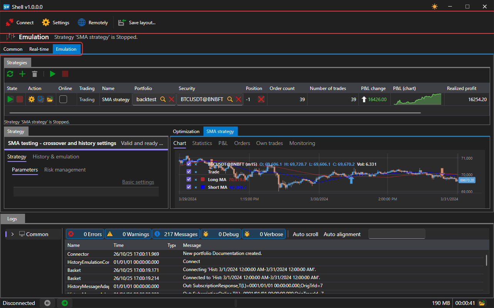
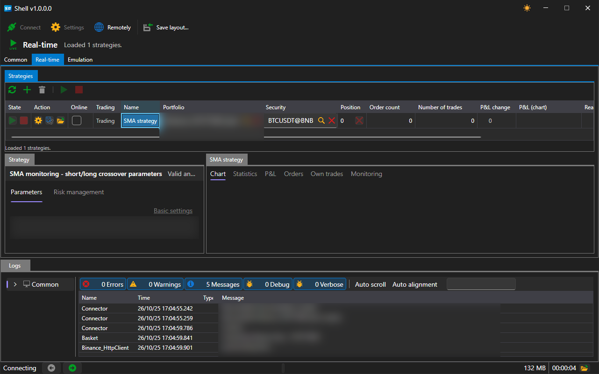
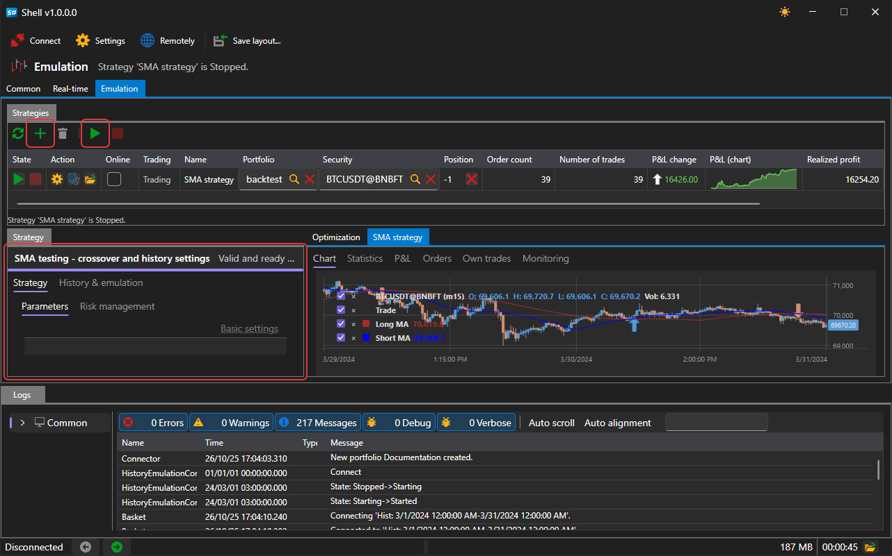

# Quick start

[Shell](../shell.md) is source code in [C#](https://en.wikipedia.org/wiki/C_Sharp_(programming_language)) that is opened in Visual Studio, Rider or any other environment and started as a regular application:

```
dotnet run --project Shell.Avalonia/Shell.Avalonia/Shell.Avalonia.csproj
```

No preliminary setup is needed: the project starts as is and works right away on the strategies included in the delivery.

## Main window

After the start, a window like this opens:



On the left is the list of workspaces between which the application switches. At the top is the command bar: the connection settings button, the **Connect** button and saving the current panel layout. At the bottom is the status bar with the current connection state.

Everything Shell writes — connection settings, the window layout, the list of strategies, imported Designer schemes and the local quote storage — is located in the `Data` folder next to the executable file.

## Connection

Go to the connection settings and select the required connector. How to set up a connection is described in the [Connections settings](connections_settings.md) section.

Then click **Connect**. The connection state is displayed in the status bar and next to the button.

After connecting, the portfolios, securities, orders and own trades received from the connection appear on the [Common](user_interface/common.md) tab.


## Strategy in trading

Go to the [Real-time](user_interface/real_time.md) tab.



Click **Add** and select a strategy in the window that opens.


The strategy appears in the **Strategies** table, and its parameters appear on the **Strategy** panel on the left. Fill in the **Security**, **Portfolio**, volume and the parameters of the strategy itself, and then click **Start**.

While there is no connection, the add and start buttons in this area are unavailable — the hint under the table says so.

## Strategy on history

The same on the [Emulation](user_interface/emulation.md) tab starts the strategy not in trading but on historical data.



No connection is needed for this: each run reads the history from the disk through its own emulation connector.

## See also

[Common](user_interface/common.md)

[Real-time](user_interface/real_time.md)

[Emulation](user_interface/emulation.md)
