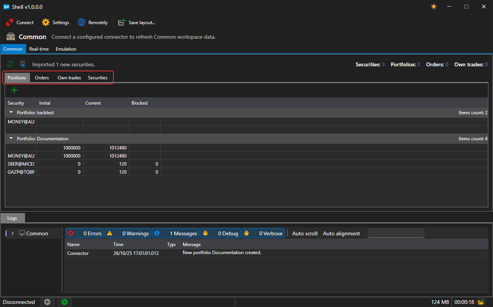

# Common

The **Common** tab shows what has come from the connection: portfolios, positions, orders, own trades and securities.

The area is made of separate panels. Any of them can be dragged by its header to another place, the area can be split vertically or horizontally, and a panel can be undocked into a separate window and docked back. The layout is saved with the **Save layout...** button on the command bar and restored at the next start.

| Panel | What it shows |
|---|---|
| **Portfolios** | portfolios and the positions on them |
| **Orders** | orders and registration failures |
| **Own trades** | own trades |
| **Securities** | securities known to the connection or loaded from the local storage |

While there is no connection, the panels are empty, and the status bar at the bottom of the window shows a hint that you need to connect.

On the right of the command bar, the number of securities, portfolios, orders and trades currently in the area is shown.

The button with the securities image on the command bar adds securities from a folder with history: it asks for the folder, adds the securities found in it to the directory and shows next to the button how many have been added. They appear in the table after connecting — the panels of this area show what the connection sends.

## Recommended content

[Real-time](real_time.md)

[Logs](log.md)
