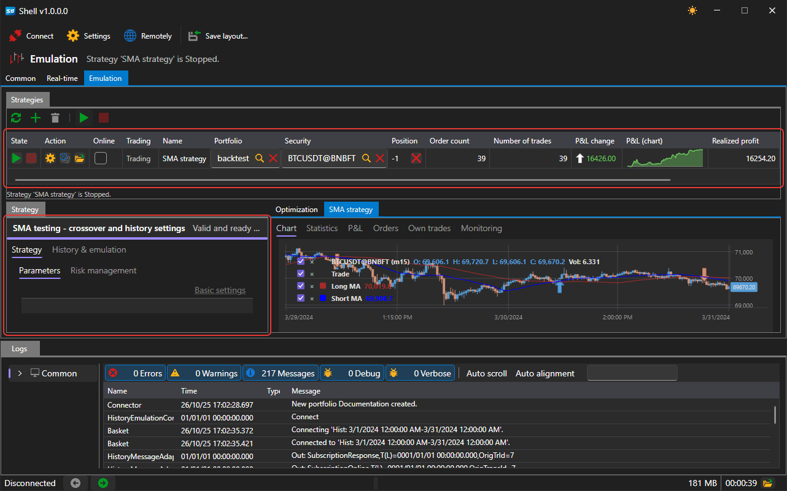
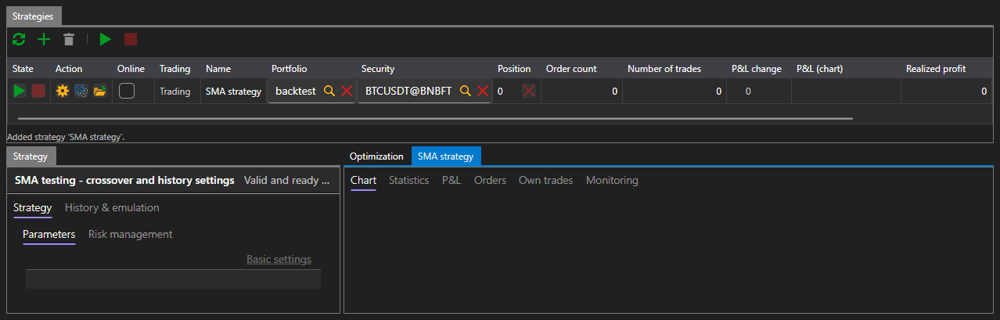
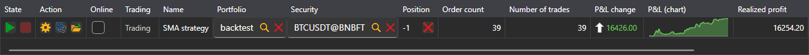
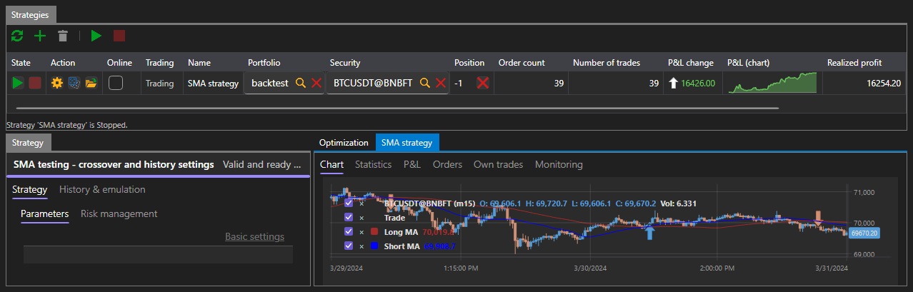
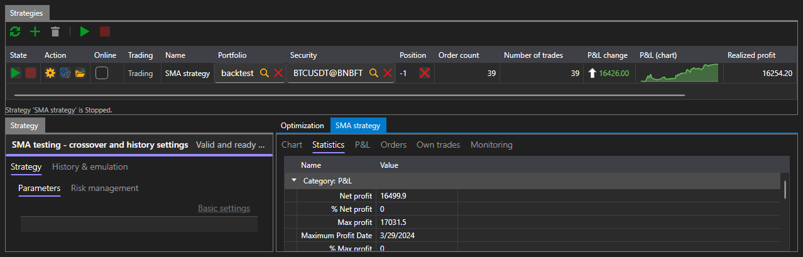
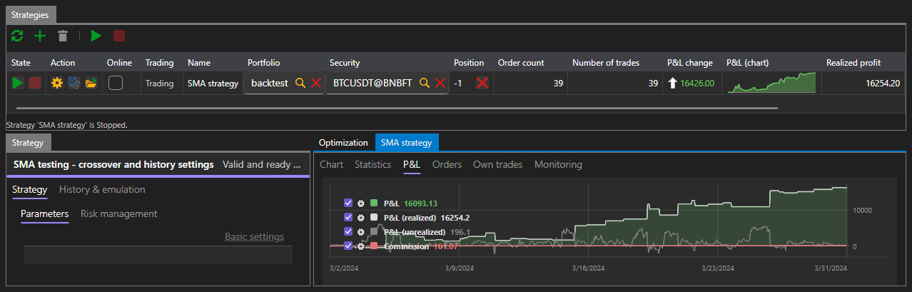
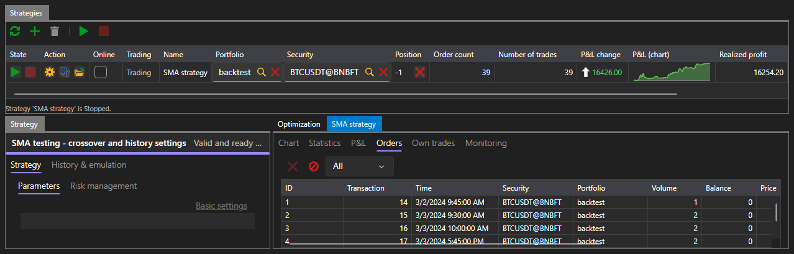
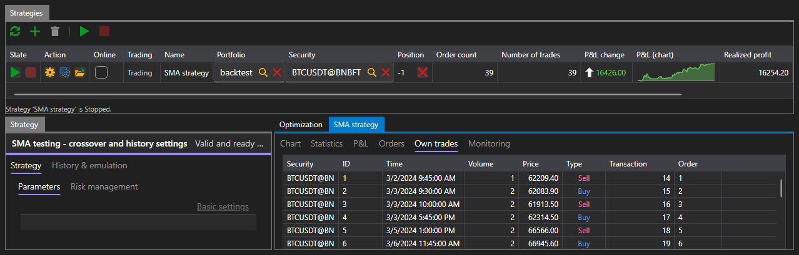

# Emulation

The **Emulation** tab runs a strategy on historical data. No connection is needed for this: each run reads the history from the disk through its own emulation connector.

The area is arranged the same way as [Real-time](real_time.md): the **Strategies** table with buttons at the top, the panel of the selected strategy on the left, and on the right the tabs with everything the run has produced. The differences are two tabs on the strategy panel and the **Optimization** tab among the results.

## Run parameters

On the left is the **Strategy** panel, where everything the strategy goes to history with is set. It has two tabs:

- **Strategy** — the instrument, portfolio, volume, risk rules and the strategy's own parameters;
- **History & emulation** — where to take the data from and how to feed it to the strategy.

| Parameter | What it sets |
|---|---|
| **History path** | the folder from which the run reads candles and ticks |
| **From**, **To** | the first and the last day of the run |
| **Storage format** | in what form the history is stored on the disk |
| **Match on touch** | execute an order when the price touches it, without waiting for the price to pass through it |
| **Session state** | reject orders while the venue is not trading |
| **Latency** | the delay between sending an order and its receipt by the venue, in milliseconds |

By default, the history installed together with the platform and the period this history covers are filled in — that is, the first run can be started without changing anything.

If the parameters are filled in incorrectly — no path is specified, the end of the period is earlier than its start, a negative delay — a message about it appears under the table, and the run does not start.

## Run

The **Start** button starts the run, and the bar under the panel header shows how much has been passed. The run ends by itself when the history ends; the **Cancel** button stops it early.

While the run is in progress and after it ends, the strategies table shows the same as in trading: the state, position, number of orders and trades, profit and loss.

## Result

On the right are the tabs between which everything the run has produced is switched:

| Tab | What it shows |
|---|---|
| **Chart** | the candles of the instrument and the strategy trades on them |
| **Statistics** | all the indicators the platform calculates |
| **P&L** | the equity curve |
| **Orders** | all the orders the strategy has placed |
| **Own trades** | all the trades it has had |
| **Optimization** | [parameter iteration](optimization.md) |

### Chart

The chart shows the candles of the instrument the run was on and the marks of the strategy trades on them.

### Statistics

The statistics are grouped into sections — profit and loss, trades, orders, latencies. Among other things, they show the net profit, the maximum drawdown in money and in percent, the number of profitable and losing trades, the average profit per trade, the profit factor and the Sharpe, Sortino, Calmar and Sterling ratios.

The number of trades in the statistics is smaller than in the strategies table: the statistics count the trades that closed something, and the trade that opened the first position is not among them.

### P&L

The equity curve shows how the result of the strategy changed during the run.

### Orders and trades

The **Orders** tab has everything the strategy has placed: the time, direction, type, volume, price and state of each order.

The **Own trades** tab has what has been executed from these orders.

## See also

[Optimization](optimization.md)

[Real-time](real_time.md)
