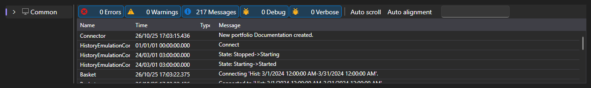

# Logs

The **Logs** tab shows everything the application reports about its work: messages of the connection, strategies, emulation and the shell itself.

Each record is the time, the level (debug, info, warning, error), the source and the text. Strategy records are marked with the strategy identifier, so when several strategies are running at the same time, you can see whose message it is.

Above the table, the number of accumulated errors and warnings is shown, along with a button that clears the log. The table itself can filter records by level, search by text, select columns and export its contents.

The logs are the first place to look if a strategy does not start, does not place orders, or a run on history ends right after it begins.

## See also

[Common](common.md)
