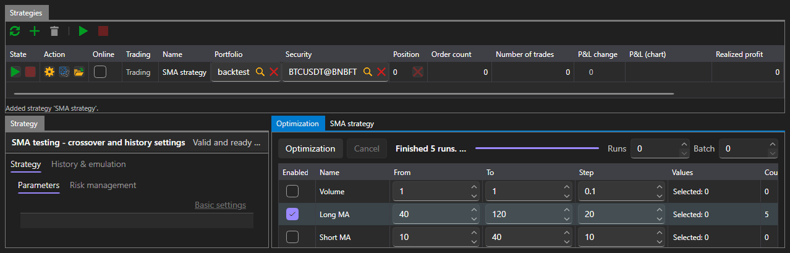

# Optimization

The **Optimization** tab selects the strategy parameters by iteration: it runs the same strategy on the same history as many times as there are combinations of parameters, and shows the result of each run.

Optimization is available only in the [Emulation](emulation.md) area. [Real-time](real_time.md) does not have this tab: there is nothing to iterate parameters with on a live connection.

## What to iterate

The parameter table lists the parameters of the selected strategy that can be iterated. A parameter takes part in the iteration only when it is checked; for a checked one, the start, the end and the step are set. What exactly can be entered depends on the parameter type: an integer has integer values, a boolean has only two values.

The iteration bounds are set to the right of the buttons:

| Field | What it sets |
|---|---|
| **Runs** | the maximum number of runs to make; 0 means no limit |
| **Batch** | how many runs to execute at the same time |

The number of combinations is recalculated as the parameters are checked, so you can see in advance what the iteration will amount to.

## Iteration progress

The **Optimization** button starts the iteration, and **Cancel** stops it. The status line says what is happening: the iteration is being planned, so many runs are being executed, the iteration has stopped after so many runs, the iteration has not produced a single run. The bar next to it shows how much has been passed.

## Result

The result is shown in three ways at the same time:

- a table where each row is one run with its parameter values, final profit and equity curve;
- a surface over two selected parameters;
- the same surface as a heat map.

Selecting a row in the table shows the equity curve of that run.

## See also

[Emulation](emulation.md)
