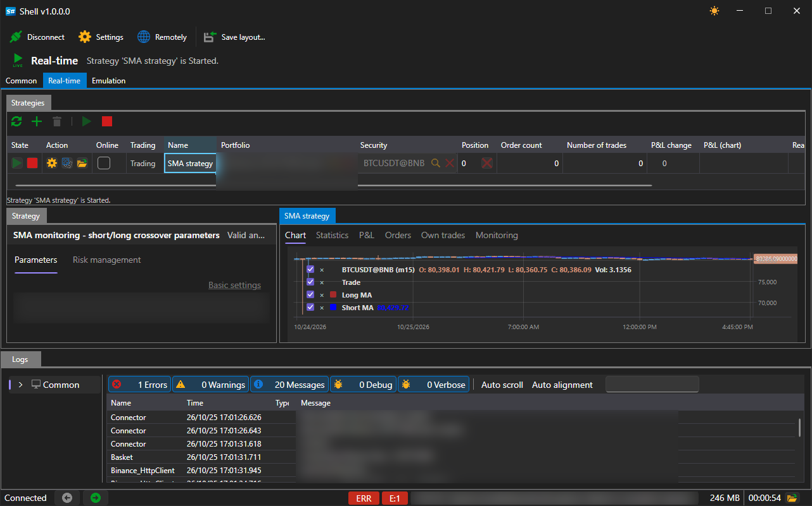
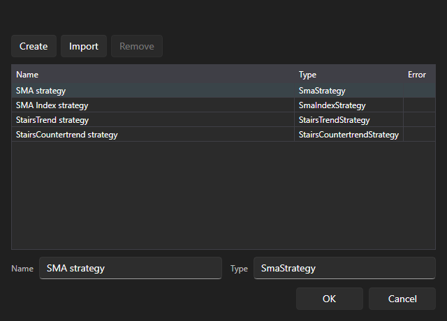

# Real-time

The **Real-time** tab manages the strategies launched in trading.

The area consists of three parts:

- **Strategies** — the table of all strategies of the area and the buttons for managing them, at the top;
- **Strategy** — the parameters of the selected strategy, on the left;
- the tabs on the right — **Chart**, **Statistics**, **P&L**, **Orders** and **Own trades**: everything the selected strategy shows, has placed and has executed.

Working with this area is possible only when a connection is established: without it, the buttons are unavailable, and a hint about it is shown under the table.

## Buttons

| Button | What it does |
|---|---|
| **Refresh** | reads the list of strategies again |
| **Add** | opens the strategy selection window |
| **Remove** | removes the selected strategy from the area |
| **Start** | starts the selected strategy in trading |
| **Stop** | stops it |

## Strategies table

Each row is one strategy. The columns show its state and result:

| Column | What it shows |
|---|---|
| **State** | stopped, starting, running, stopping |
| **Action** | starting, stopping and closing the position right from the row |
| **Online** | whether the strategy receives real-time data |
| **Trading** | the trading mode of the strategy |
| **Name** | the name set when it was added |
| **Portfolio**, **Security** | what it trades on |
| **Position** | the current position |
| **Order count**, **Number of trades** | how many orders have been placed and how many trades have been executed |
| **P&L change**, **P&L (chart)** | profit and loss and their dynamics |
| **Realized profit**, **Unrealized profit** | the closed and the open part of the result |
| **Error** | the last error of the strategy, if there was one |

## Adding a strategy

The **Add** button opens a window with the list of available strategies.

The window lists the four bundled strategies and everything that has been imported from [Designer](../run_strategies_from_designer.md). The **Import** button adds a scheme exported from Designer to this list; the **Create** button adds a blank for your own strategy; the **Remove** button removes the selected entry from the list.

After clicking **OK**, the strategy appears in the table, and its parameters open on the **Strategy** panel: the instrument, portfolio, volume, risk rules and the strategy's own parameters — for example, the moving average lengths and the candle time frame for **SMA strategy**.

## See also

[Common](common.md)

[Emulation](emulation.md)
