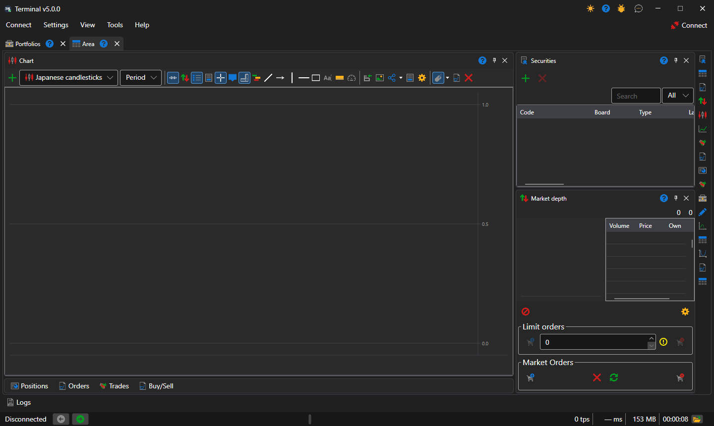
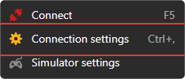
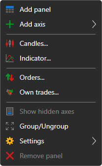
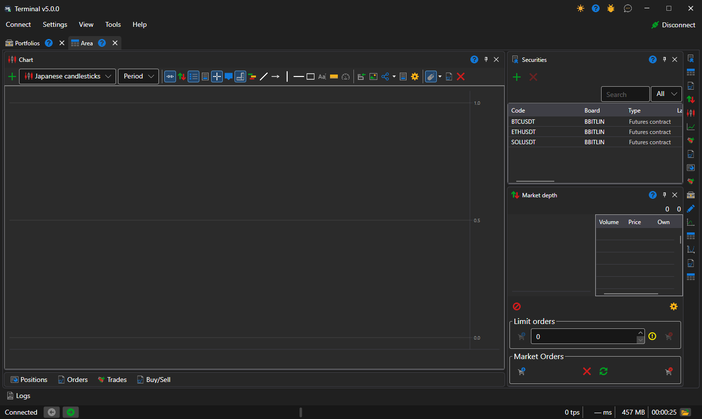
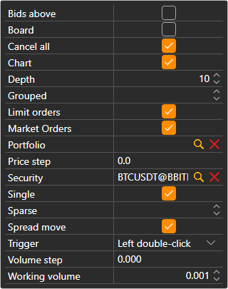
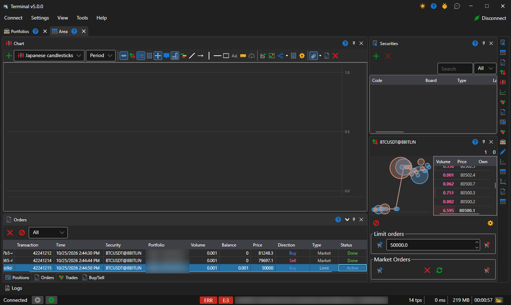
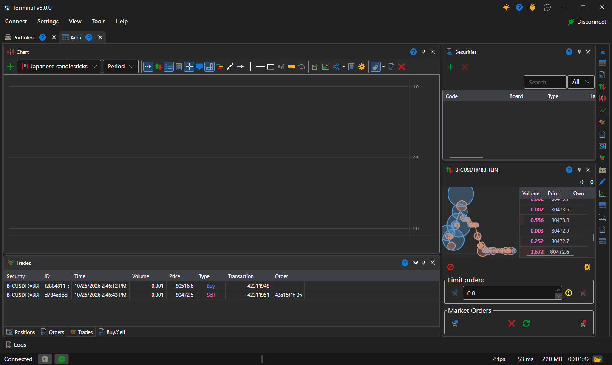
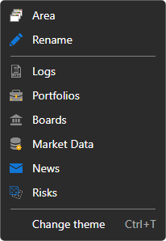

# Quick start

When you start [Terminal](../terminal.md) for the first time, a window opens with one [workspace](user_interface/workspace.md) arranged by default: the chart in the center, the instruments and the order book on the right, and under the chart the collapsed tabs of positions, orders, trades and the **Buy/Sell** ticket.

Let's go to the connection settings — the **Connect → Connection settings** menu — and select the required connection. How to set up the connection is described in the [Connection settings](connection_settings.md) section.

The next step is to connect by clicking the **Connect** button at the end of the [main menu](user_interface/ribbon.md) bar or by pressing the **F5** key.

Clicking the **Add**  button on the chart panel we add a new chart area. Right clicking the mouse button on the chart area, we add candles to it by the instrument of interest to us. We can add indicators, own trades and orders to the chart. There is also a possibility to register orders from the chart. For more information on how to work with the chart, see the [Chart](user_interface/components/chart.md) section.

Clicking the **Add**  button on the Instrument panel adds the instruments you want to watch. The best price data will be displayed here. For more information on how to work with the Instrument panel, see the [Instruments](user_interface/components/instruments.md) section.

In the order book, after clicking the **Settings**  button, a panel appears where you can specify the **Instrument** and the **Portfolio** for the trades. Here you can also adjust the order book depth. For more information on how to work with an order book, see the [Order book](user_interface/components/order_book.md) section.

Let’s register the first few orders. Orders can be registered either by clicking the **Buy/Sell** buttons or by double-clicking the cells in the **Bid/Offer** columns of the order book itself. The order panel displays all your orders. When you right-click an order, you will see a panel that lets you submit a new order, cancel, or change the selected order. For more information on how to work with the order panel, see the [Orders](user_interface/components/orders.md) section.

In the Trades panel, you can view trades by instruments. For more information on how to work with the Trades panel, see the [Trades](user_interface/components/trades.md) section.

If necessary, you can add additional components — with the buttons of the strip at the right edge of the workspace; the panels of the whole window, for example **Portfolios** and **Logs**, are opened from the **View** menu. All components are described in the [Components](user_interface/components.md) section.

