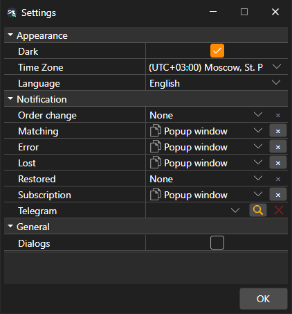

# General settings

The **Settings** window is opened with the **Settings → Settings** item of the [main menu](../user_interface/ribbon.md). Its settings are divided into groups:

- **Appearance**:
  - **Dark** — the dark theme; the button in the window title switches it as well;
  - **Time Zone** — the time zone in which the market data time is shown;
  - **Language** — the program language.
- **General**:
  - **Dialogs** — show a window with an error that the program has not handled itself. If the check box is cleared, such an error is only written to the log.
- **Notification** — which order and connection events to report and in which way, as well as the Telegram channel for such messages. See the [Notifications](../notifications.md) section for details.

The theme changes right after clicking **OK**. The language and the time zone take effect after a restart, so Terminal asks whether to restart now.

## See also

[Reset settings](reset_settings.md)

[Notifications](../notifications.md)
