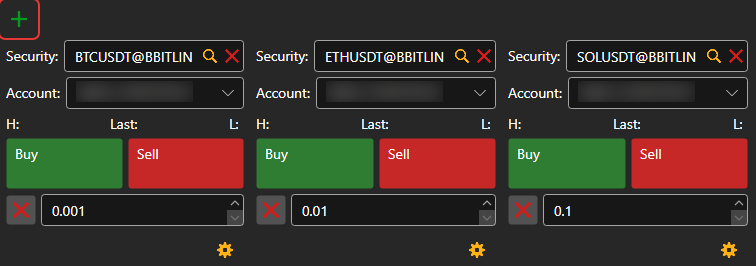
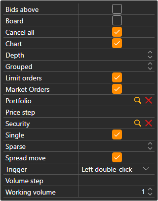

# Buy\/Sell

The **Buy\/Sell** component is a group of tickets. Each ticket shows the best prices of one instrument and places orders on it for the selected portfolio. A ticket is added with the  button; at the first connection, the panel creates tickets for the first instruments of the venue by itself.

## Ticket settings

The gear button under a ticket opens its settings: **Security**, **Portfolio**, **Working volume**, the order book **Depth**, and which blocks the ticket shows:

- **Limit orders** — the **Buy** and **Sell** buttons with a price field between them; the buttons next to the field put the best bid or ask price into it;
- **Market Orders** — **Buy**, **Sell**, **Close position** and **Reverse position** at market;
- **Cancel all** — a button that cancels all orders for the instrument of the ticket.

The instrument of the ticket can be changed by dragging a row from [Instruments](instruments.md) onto the ticket; if you drag a row from [Positions](positions.md), the ticket takes its instrument and portfolio.

## Hotkeys

The ticket of the **Buy\/Sell** panel of the [workspace](../workspace.md) that is open now responds to keys: **F9** — buy at market, **F10** — sell at market, **Esc** — cancel all orders. While the cursor is in an input field, the keys do not work.

> [!WARNING]
> **F9** and **F10** send real market orders to the venue without confirmation.

## Recommended content

[Order book](order_book.md)

[Level 2](level_2.md)

[Main menu](../ribbon.md)
