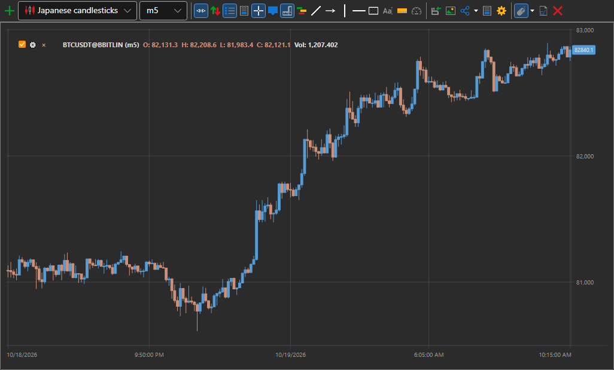
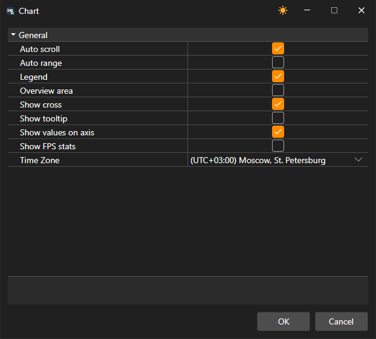

# Chart

The **Chart** component allows you to draw candles and indicators for the selected instrument. 

To add a new area, click the  button. 

To add a new element to the chart, right-click anywhere in the chart area and select the required element; available options include candles, indicators, orders, and own trades.

The upper-left corner of each chart shows all graphical elements added to the chart. If you clear the checkbox  for a graphical element, that element is also removed from the chart.

Clicking  opens the settings for the graphic element.

## Trading from the chart

You can place, move and cancel orders from the chart. First, turn on the **Place orders from chart** switch on the chart button bar, and in its drop-down settings specify the **Security**, the **Portfolio** and the order volume.

- A buy order is placed with **Ctrl+Left mouse button** at a price on the chart, and a sell order with **Ctrl+Right mouse button**.
- Your active orders are drawn on the chart as lines at their prices. A line can be grabbed and dragged to another price — the order will be moved; the cross at the line cancels the order. The **Cancel orders** button cancels all orders of the chart.
- The **Show quick orders panel** button displays a panel over the chart with the **Sell** button at the best bid and the **Buy** button at the best ask, the spread between them and the order volume. The panel can be dragged anywhere on the chart.

> [!WARNING]
> Orders from the chart are sent to the venue immediately, without confirmation.

## Chart settings

The **Settings** button on the chart button bar opens the settings window of the whole chart: auto scroll and auto scale, the legend, the view area, the crosshair, the tooltip, the values on the axes, the FPS statistics and the time zone in which the time scale is labeled.

A right-click on the button bar itself opens the list of its buttons: clearing a check box hides the button, selecting it brings the button back. Which buttons are shown is saved together with the chart.

The **Clipboard (as image)** button copies the chart picture so that you can paste it into a message or a document. A right-click on a chart element opens a menu with the **Element parameters…** and **Delete** items; the chart area menu has **Settings → Chart area…** and **Remove panel**. A panel under the chart can also be closed with the cross in its header.

The chart is scrolled with the **←** and **→** arrows, the **Home** and **End** keys go to the beginning and the end of the data, and **+** and **−** change the scale.

In the graphical element settings, you can set the required chart style: Japanese candles, bars, box chart, cluster profile, etc.

For a box chart, candles can also be grouped; the grouping order is set in the fields: the multiplier of the 2nd timeframe and the multiplier of the 3rd timeframe.

There is a toolbar above the chart, where you can select auto scroll, auto-zoom, legend modes and other general chart settings. You can also select the elements to draw on the chart: lines, levels, pointers, rectangle, text.

## See also

[Orders](../../../designer/user_interface/components/orders.md)
