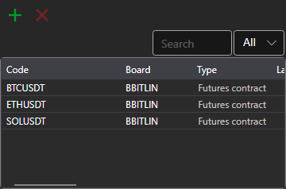

# Instruments

The **Instruments** component (the panel title is **Securities**) is a table with instruments that displays information about all selected instruments.

To add a new instrument, click the  button. The instrument selection window opens: it has a search and a filter by instrument type and by board, and while the list of instruments is loading, a loading bar is shown under the table. The **Delete securities** button removes the selected instruments from the table.

The instrument selected in the table is shown in the **Properties** panel of the same workspace. If the chart of the area does not have an instrument for placing orders yet, the selected instrument becomes it.

An instrument row can be dragged with the mouse onto another panel of the area — [Buy/Sell](buy_sell.md), [Level 1](level_1.md), [Level 2](level_2.md), [Order book](order_book.md) or [Chart](chart.md) — and the panel switches to this instrument.

How to copy rows, search and filter them, and configure columns is described in the [Working with tables](../tables.md) section.

## Recommended content

[Level 1](level_1.md)
