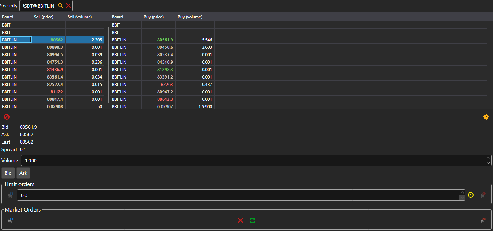

# Level 2

The **Level 2** component shows the quotes of an instrument on all venues at once: every instrument with the same code goes into the tables, one row per instrument. The left table has the best selling price and volume, the right one the buying ones. The instrument is selected in the field above the tables or dragged onto the panel from [Instruments](instruments.md).

Under the tables are the bid, ask, last price and spread of the row selected in the table. The **Bid** and **Ask** buttons put this price into a limit order, and below is the same ticket as in the [Buy\/Sell](buy_sell.md) component: limit and market orders.

## See also

[Order book](order_book.md)

[Buy\/Sell](buy_sell.md)
