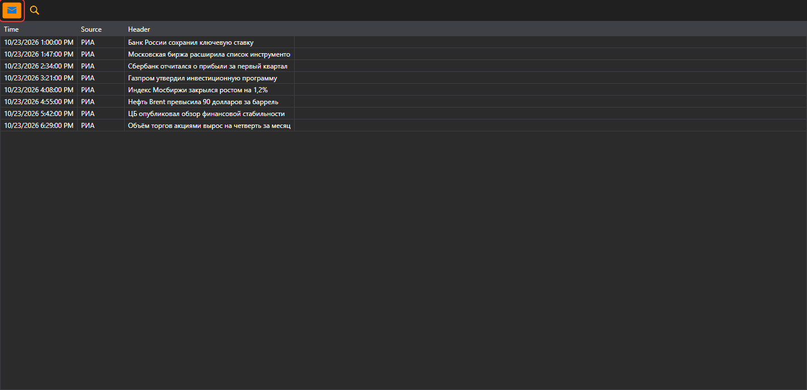

# News

The **News** component displays news received from connections.

To start receiving news, click the **Receive news** button.

## Recommended content

[Positions (options)](positions_options.md)
