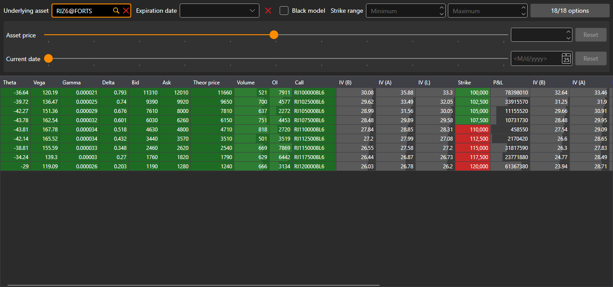

# Option desk

The **Option desk** component is a table of the main parameters of options for the underlying instrument: a table row is a strike, the call parameters are on the left, and the put parameters are on the right.

## Option filter

There is a filter above the table. It is the same for all option components — the desk, the [smile volatility](smile_volatility.md) and the [positions by options](positions_options.md):

- **Underlying asset** — the instrument whose options are shown;
- **Expiration date** — show only the options of this expiration date; the button next to it clears the filter;
- **Black model** — calculate theoretical prices, volatility and the Greeks by the Black model (for options on futures) rather than by the Black–Scholes model;
- **Strike range** — the minimum and the maximum strike;
- the button with the number of options opens the window for selecting the options of the underlying asset. The button shows how many of the selected options pass the filter and how many are selected in total.

Below the filter is the "what if" calculation. The **Asset price** slider and the field next to it set another price of the underlying asset, and the **Current date** slider and the calendar set another current date. The calculations of the component are made for these values, and the **Reset** buttons return the real price and date.

## Table

The "in the money" strikes are highlighted: for a call, these are the strikes below the price of the underlying asset, for a put, the strikes above it.

Double-clicking a call or put cell opens the order book of this option.

## Recommended content

[Smile volatility](smile_volatility.md)
