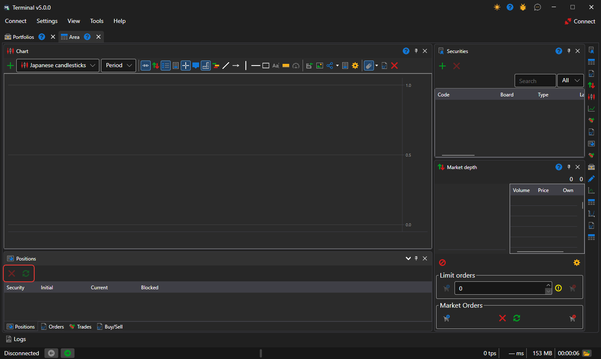

# Positions

The **Positions** component is a table of current positions by instruments and portfolios: the volume, the average price, profit and loss.

Above the table are the **Close position** button — a market order that brings the selected position to zero — and the **Reverse position** button — a market order for twice the position volume, after which the position becomes the same size, but in the other direction. A position row can be dragged onto a [Buy\/Sell](buy_sell.md) ticket: the ticket takes its instrument and portfolio.

## See also

[Positions](../../../designer/user_interface/components/positions.md)

[Buy\/Sell](buy_sell.md)
