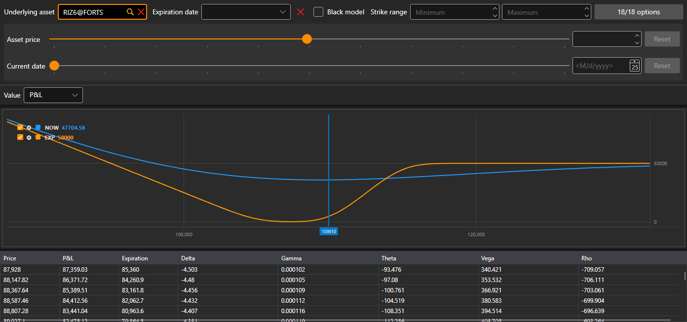

# Positions (options)

**Positions (options)** is a graphic display of the position by options: how its indicator depends on the price of the underlying asset.

The options are selected with the same filter as on the [option desk](option_desk.md): the underlying asset, the expiration date, the strike range and the options themselves. The "what if" calculation under the filter shows the position at another price of the underlying asset and on another date.

The **Value** list selects what to plot: **P&L**, **Delta**, **Gamma**, **Theta**, **Vega** or **Rho**. Under the chart is a table of values by the prices of the underlying asset: **Price**, the P&L now, the P&L at **Expiration** and the Greeks.

## Recommended content

[Option desk](option_desk.md)
