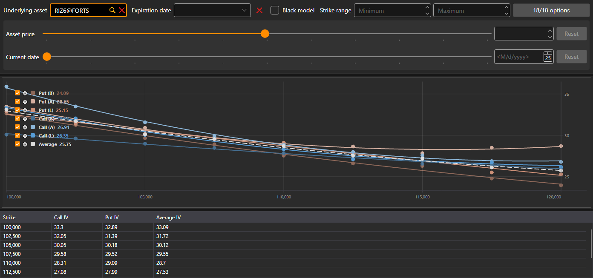

# Smile volatility

The **Smile volatility** component is a graphic representation of the expected volatility level for options with the same underlying asset and different strikes.

The options are selected with the same filter as on the [option desk](option_desk.md): the underlying asset, the expiration date, the strike range and the options themselves.

The chart has seven curves: the implied volatility of calls and puts by the best bid, by the best ask and by the last trade price, and, dashed, the **Average** of the call and put volatility at each strike. Under the chart is a table: **Strike**, the **Call** and **Put** volatility (by the last trade price, and if there were no trades, by the best bid or ask) and their **Average**.

## Recommended content

[Option desk](option_desk.md)

[Positions (options)](positions_options.md)
