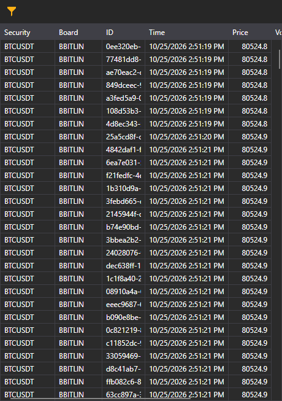

# Trades feed

The Terminal trades feed displays market trades for selected instruments. The shared tick trades guide explains the instrument filter of this component.

See 

[Tick trades](../../../designer/user_interface/components/tick_trades.md)
