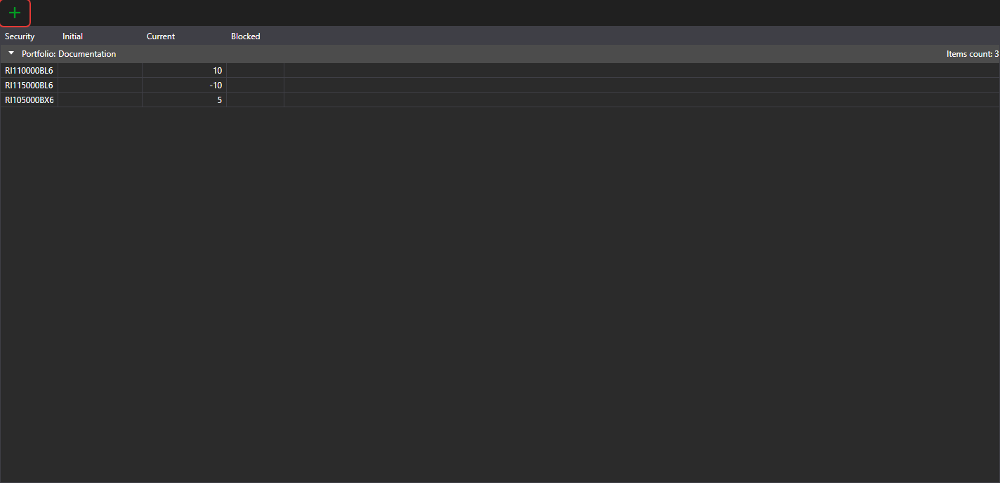

# Portfolios

The **Portfolios** panel shows portfolio data and the associated positions. It is opened with the **View → Portfolios** item of the [main menu](ribbon.md).

The  button creates a position, and its drop-down menu creates a portfolio or a position. Double-clicking a row opens the position for editing.

The menu that opens with a right-click on a row has, besides the common items of [tables](tables.md):

- **Edit** — open the position for editing;
- **Close position** — place a market order that closes the position;
- **Reverse position** — place a market order for a volume twice as large as the position, so that the position changes its direction;
- **Withdraw** — withdraw funds from the venue: the window specifies the amount and the withdrawal details. The item is available for a positive position in an asset if the portfolio connection supports withdrawals;
- **Hide zero balances** — do not show positions with a zero balance.

More about portfolios, positions and editing them is in the shared guide: [Portfolios](../../designer/user_interface/portfolios.md).
