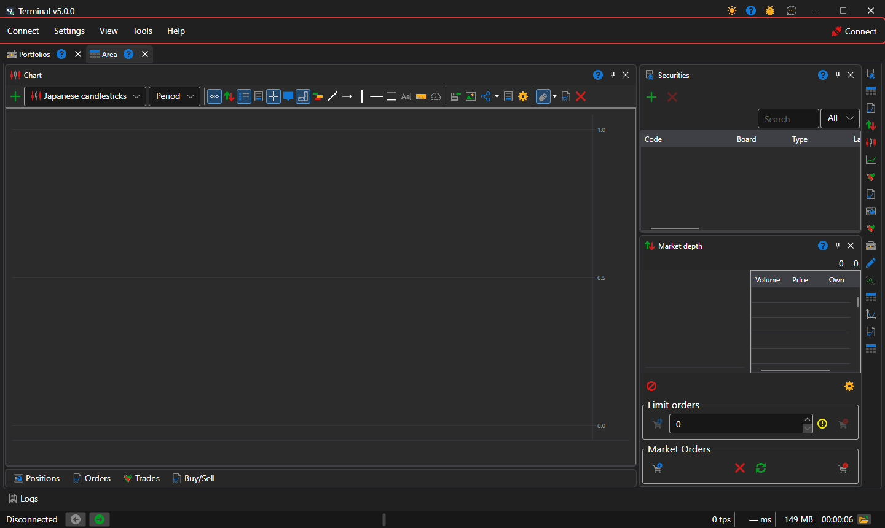

# Main menu

Below the window title of [Terminal](../../terminal.md) is the menu bar: **Connect**, **Settings**, **View**, **Tools** and **Help**. At the end of the bar is the **Connect** button: it connects Terminal to all [configured connections](../connection_settings.md), and while the connection is established, it is named **Disconnect**. While Terminal is connected, the connection and emulator settings are unavailable.

In the window title, next to the minimize and close buttons, are the buttons for changing the theme, help, **Report a problem** and **Contact us**.

## Menu items

- **Connect** — connecting and disconnecting, [connection settings](../connection_settings.md) and the settings of the emulator, which executes orders on real market data without sending them to the venue.
- **Settings** — the [general settings](../settings/common_settings.md) of the program; **Save layout...** and **Reset layout**, which returns the panels to their original places; [reset settings](../settings/reset_settings.md); the **Securities and connections** and **Portfolios and connections** windows, in which an instrument or a portfolio is assigned the connection through which it is traded.
- **View** — a new [workspace](workspace.md) (**Area**) and renaming the current one (**Rename**); the panels of the whole window: [Logs](logs.md), [Portfolios](portfolios.md), [Board editor](board_editor.md), **Market data**, [News](components/news.md), [Risks](risk_management.md); changing the theme.
- **Tools** — **Create new security**, **New index instrument** made of several instruments and **Continuous security** made of futures with different expirations; the created instrument appears at once in the [Instruments](components/instruments.md) of the open area.
- **Help** — **Documentation**, **Bug report**, contacting the StockSharp team and the **About** window.

## Hotkeys

| Keys | Action |
|---|---|
| **F5** | connect or disconnect |
| **Ctrl+,** | connection settings |
| **Ctrl+S** | save the layout |
| **Ctrl+T** | change the theme |
| **F1** | open the help |
| **Alt+C**, **Alt+S**, **Alt+V**, **Alt+T**, **Alt+H** | open the **Connect**, **Settings**, **View**, **Tools**, **Help** menu |
| **F9** | buy at market in the active [Buy/Sell](components/buy_sell.md) ticket |
| **F10** | sell at market in the active ticket |
| **Esc** | cancel all orders of the active ticket |

The active ticket is the ticket of the **Buy/Sell** panel of the workspace that is open now. The **F9**, **F10** and **Esc** keys do not work while the cursor is in an input field.

> [!WARNING]
> **F9** and **F10** send real market orders to the venue without confirmation.

## See also

[Workspace](workspace.md)

[Components](components.md)
