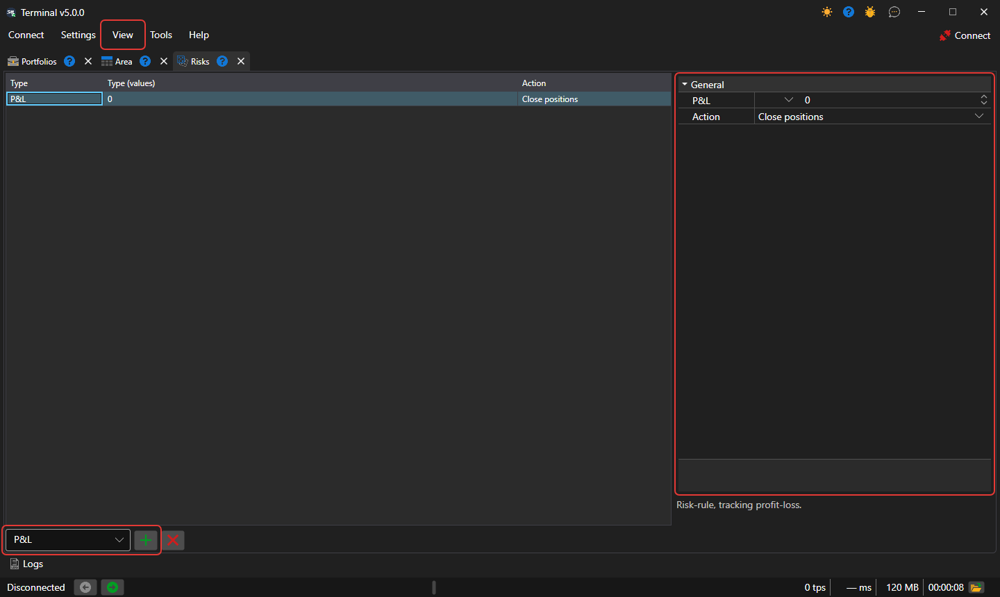

# Risk management

In the **Risks** panel, you can set risk control settings. The panel is opened with the **View → Risks** item of the [main menu](ribbon.md).

To add a **Risk-rule**, select its type in the list under the table and click the **Add rule** button. The rule appears in the table, and its settings appear on the right: the trigger condition for the **Risk-rule** and the action (Close positions, Stop trading, Cancel orders), which will be executed when the condition is triggered. The description of the selected rule is shown under the settings. The **Delete rule** button deletes the selected rules.

The rules are checked by the Terminal connection — on the orders, trades and portfolio data that pass through it. The set of rules is saved between program launches.

The list of risk rules and their description is available in the section [Risk management](../../designer/user_interface/risk_management.md).
