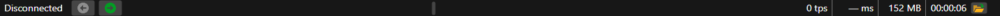

# Status bar

At the bottom of the [Terminal](../../terminal.md) window is the status bar. From left to right, it contains:

- **the state** — **Disconnected**, **Connecting**, **Connected**, **Disconnecting** or the connection error text. Terminal also writes the result of the last action here, for example "Layout saved." or "Security created: …";
- **StockSharp news** — the headlines of the website news; they can be scrolled with the arrow buttons;
- **the counters of warnings and errors** of the log — they appear when the log has warnings or errors;
- **the last log message** — a right-click on it copies its text to the clipboard. The whole log is in the [Logs](logs.md) panel;
- **ticks per second** (tps) — how many market trades (ticks) Terminal has received in the last second;
- **the latency** (ms) — by how many milliseconds the last tick or the last Level 1 change arrived later than its time on the venue;
- **the memory** taken by the Terminal data, in megabytes;
- **the uptime** of the program since its start;
- the **Log directory** button — opens the folder to which Terminal writes the log.

While Terminal is not connected, ticks and latency are not counted: the bar shows **0 tps** and **— ms**.

## See also

[Logs](logs.md)

[Main menu](ribbon.md)
