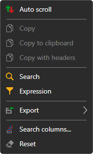
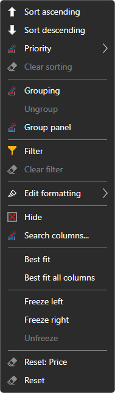

# Working with tables

The tables of all [Terminal](../../terminal.md) panels — instruments, orders, trades, positions, portfolios, Level 1, the order log, news — work the same way.

## Table menu

A right-click on the table rows opens a menu:

- **Auto scroll** — the table scrolls to new rows by itself;
- **Copy**, **Copy to clipboard** — copy the selected rows to the clipboard: the visible columns in the order in which they are shown, separated by tabs, one table row per line of text. **Copy with headers** adds the column names as the first line. **Ctrl+C** does the same as **Copy**;
- **Search** (**Ctrl+F**) — searching for text in the table. You can choose which columns to search in; the **Previous** and **Next** buttons move between the found cells, and **Clear** resets the search;
- **Expression** — a filter of rows by a condition on the column values, in the form of a formula, for example `=[Price] > 100`. The field suggests the column names and functions (`CONTAINS`, `STARTSWITH`, `ENDSWITH`, `TODAY`, `NOW` and others), shows an error in the formula at once, and **Preview** shows what the formula gives for the selected row. **Apply** turns the filter on, **Clear filter** removes it;
- **Export** — the table to the clipboard (as text in the CSV format or as a picture), to a CSV, Excel or PNG file. **Share image link** uploads a picture of the table to the StockSharp website and copies the link to it; this requires signing in to the website. **Print** opens the table in the browser, from where it can be printed;
- **Search columns...** — a window in which columns are shown and hidden;
- **Reset** — return the table to its original look.

## Column menu

A right-click on a column header opens the menu of this column:

- **Sort ascending**, **Sort descending**, **Clear sorting**. A click on the header also sorts the table by this column. **Priority** adds sorting by the column to the one already set, to sort by several columns at once;
- **Grouping** — group the rows by the column values, **Ungroup**. The **Group panel** shows the grouping levels: a column can be added from the list or dragged onto the panel by its header, the levels can be rearranged, and each level has its own sort direction;
- **Filter** — a filter of rows by the values of this column, **Clear filter**;
- **Edit formatting** — the rules by which the cells of the column are highlighted with color: **Add rule**; a rule can be edited, turned off or deleted;
- **Hide** — remove the column, **Search columns...** — bring it back;
- **Best fit** of the column and **Best fit all columns** — the width by the content;
- **Freeze left**, **Freeze right**, **Unfreeze** — a frozen column stays in place when the table is scrolled sideways;
- **Reset** the column or the whole table.

The look of the table — which columns are shown, their order and width — is saved together with the window layout.

## See also

[Workspace](workspace.md)

[Components](components.md)
