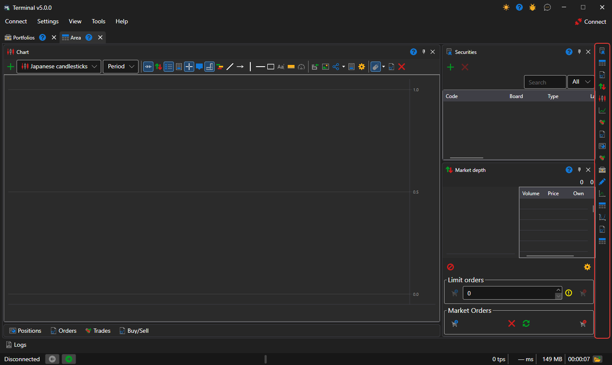
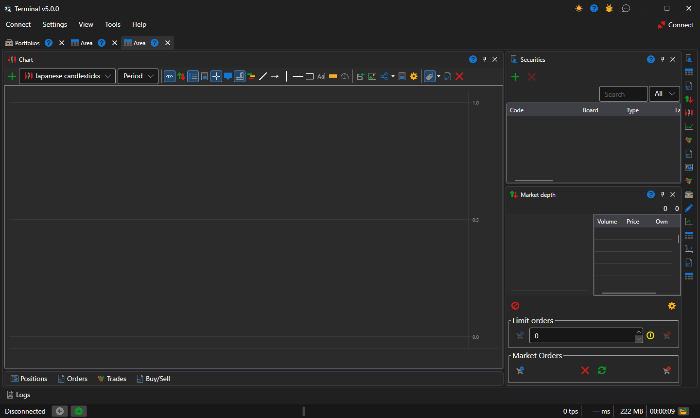

# Workspace

A workspace is a tab of the [Terminal](../../terminal.md) window with its own set of panels: charts, tables, tickets. There can be as many areas as you like, and each lives its own life: an instrument selected in one does not change the panels of another.

A new area is created with the **View → Area** item of the [main menu](ribbon.md), and the current one is renamed with the **View → Rename** item.

## Panels of the area

Panels are added with the buttons of the vertical strip at the right edge of the area — one button per [component](components.md). Each click opens one more panel of this kind, so one area can have, for example, two charts for different instruments. A panel can be dragged by its header to another place in the area, docked to the edge of a neighboring panel, stacked with it into tabs or moved out into a separate window.

## Layout of a new area

A new area is arranged the way it is customary in trading terminals: the chart in the center at full height, [Instruments](components/instruments.md) above the [Order book](components/order_book.md) on the right, and the **Positions**, **Orders**, **Own trades** tables and the **Buy/Sell** ticket collapsed into a row of tabs under the chart. A click on a tab expands the tables, and the button in their header collapses them back. Terminal remembers whether the tables are collapsed together with the panel layout.

Terminal saves the panel layout by itself on every change; **Settings → Save layout...** (Ctrl+S) saves it immediately, and **Settings → Reset layout** returns the panels to their original places.

## See also

[Main menu](ribbon.md)

[Components](components.md)
