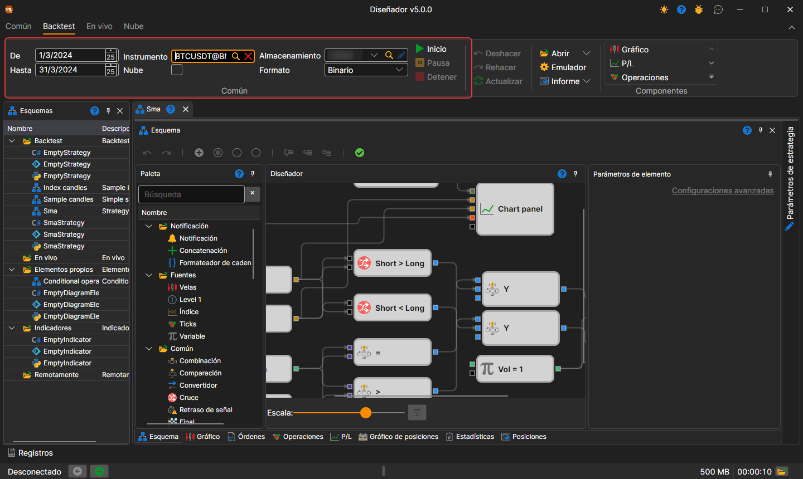
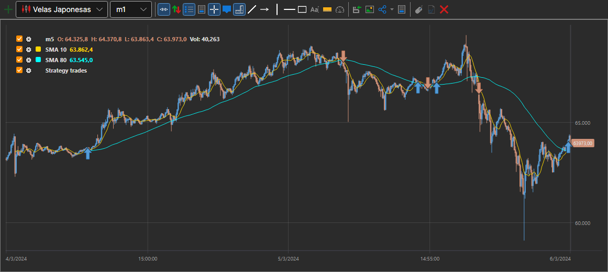
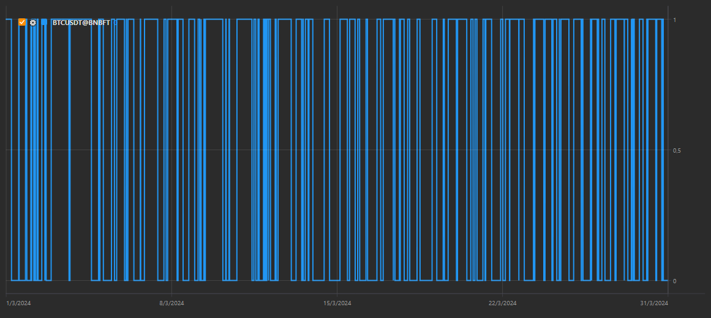
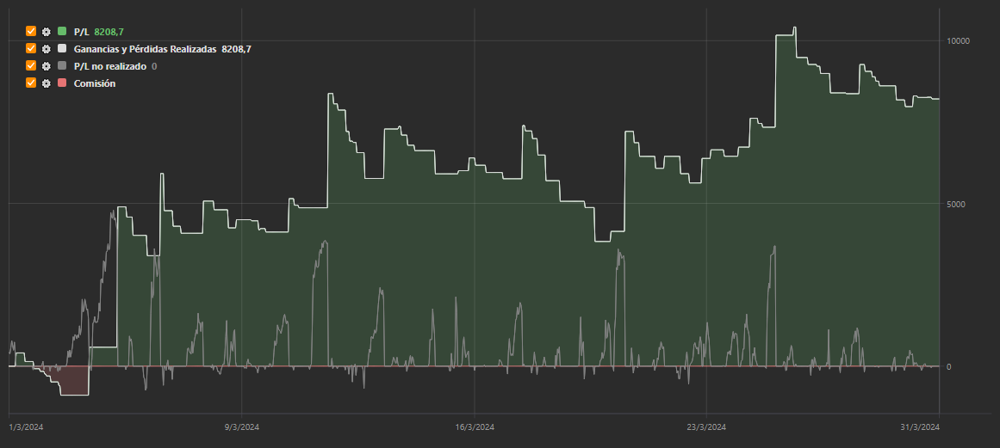

# Primeros pasos

Como ejemplo, se considerará la estrategia SMA.

Para ejecutar la prueba sobre historial, debe seleccionar una estrategia cuyo esquema se probará sobre datos históricos. La estrategia se selecciona en el panel [Esquemas](../user_interface/schemas.md), dentro de la carpeta de estrategias, haciendo doble clic en la estrategia de interés.

Antes de probar, cargue los datos de mercado (instrumentos, velas, operaciones tick y\/o libros de órdenes). Esto se describe en [Almacenamiento de datos de mercado](../market_data_storage.md).

Al cambiar a la pestaña con una estrategia, la pestaña **Backtest** se abre automáticamente en la **Cinta**. En ella defina el período de prueba (**De** y **Hasta**), seleccione el instrumento en el campo **Instrumento** y, en los campos **Almacenamiento** y **Formato**, el almacenamiento de datos de mercado ([Almacenamiento de datos de mercado](../market_data_storage.md)) y el formato en que está escrito.

En el ejemplo con la estrategia SMA se usan los siguientes parámetros:

1. Instrumento BTCUSDT@BNBFT
2. Período del 01.03.2024 al 31.03.2024
3. Almacenamiento en el que se han cargado las velas de este instrumento para este período
4. Formato de almacenamiento **Binario**

La propia estrategia construye dos medias móviles sobre velas de cinco minutos — **SMA 10** y **SMA 80** — y opera con el volumen que fija el cubo **Vol = 1** del esquema.

Después de configurar todos los parámetros requeridos, inicie la prueba de la estrategia haciendo clic en el botón .

Durante la prueba o después de ella, puede ver gráficos y tablas con la información de la prueba.

El gráfico muestra que las operaciones se realizan en la intersección de las medias móviles, tal como está previsto por la estrategia.

En el **Gráfico de posiciones** se ve que la posición de la estrategia pasa entre 0 y 1: la estrategia compra cuando la media corta cruza la larga de abajo hacia arriba y cierra la posición en el cruce inverso.

El gráfico **P\/L** muestra cómo cambiaron las ganancias y pérdidas de la estrategia durante la prueba, así como la comisión.

## Contenido recomendado

[Ejecución en vivo](../live_execution/getting_started.md)
