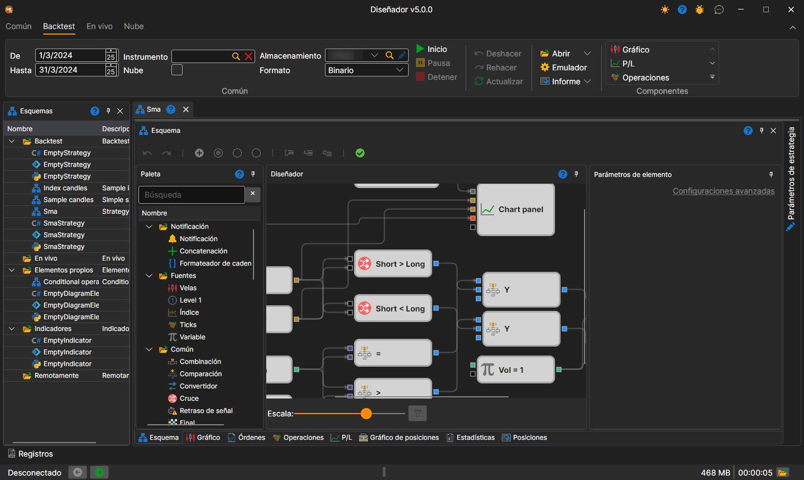
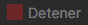
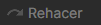

# Interfaz de usuario

Para ejecutar la prueba sobre historial, debe seleccionar una estrategia cuyo esquema se probará sobre datos históricos. La estrategia se selecciona en el panel [Esquemas](../user_interface/schemas.md), dentro de la carpeta de estrategias, haciendo doble clic en la estrategia de interés. Al seleccionar una estrategia, en el espacio de trabajo aparece una nueva pestaña con la estrategia; al cambiar a esta pestaña, la pestaña **Backtest** se abrirá automáticamente en la cinta.

En el grupo **Común** de la pestaña **Backtest** se definen el período de prueba (**De** y **Hasta**), el **Instrumento**, el almacenamiento de datos de mercado (**Almacenamiento**) y el formato en que está escrito (**Formato**). La casilla **Nube** ejecuta la prueba en la nube de StockSharp y no en este equipo.

La estrategia para pruebas se inicia haciendo clic en el botón **Inicio** . Después de iniciar la estrategia para pruebas, se activan el botón **Pausa** , que suspende la prueba, y el botón **Detener** , que detiene completamente la prueba. Al editar la estrategia, son útiles los botones **Deshacer** (Ctrl+Z) , que cancela la última acción, **Rehacer** (Ctrl+Y) , que rehace la acción deshecha, y **Actualizar** (Ctrl+R) , que actualiza completamente el esquema.

Los demás botones de la pestaña:

- **Abrir** — abrir esta misma estrategia para la [optimización](../optimization/brute_force.md) o para la [negociación](../live_execution/getting_started.md);
- **Emulador** — [configuración de la emulación](../user_interface/components/backtesting_settings.md);
- **Informe** — informe de la prueba realizada en formato Excel, JSON, XML o CSV;
- grupo **Componentes** — componentes que se pueden añadir a la pestaña de la estrategia: gráfico, P/L, operaciones y otros.

El [depurador](debugging.md) — puntos de interrupción y ejecución paso a paso — se encuentra en el panel **Esquema**.

La pestaña de la estrategia seleccionada contiene de forma predeterminada los siguientes paneles:

- El panel **Esquema**, en el que se realiza el trabajo principal de diseño de la estrategia y sus componentes, combinando cubos y líneas de conexión. El esquema se describe en detalle en la sección [Panel de diagrama](../strategies/using_visual_designer/diagram_panel.md).
- Paneles de componentes de información — **Gráfico**, **Órdenes**, **Operaciones**, **P/L**, **Gráfico de posiciones**, **Estadísticas**, **Posiciones** — como pestañas debajo del esquema.
- El panel **Parámetros de estrategia**, contraído de forma predeterminada junto al borde derecho de la pestaña de estrategia: los parámetros del esquema que se pueden cambiar antes del inicio.

## Contenido recomendado

[Configuración de pruebas históricas](../user_interface/components/backtesting_settings.md)
