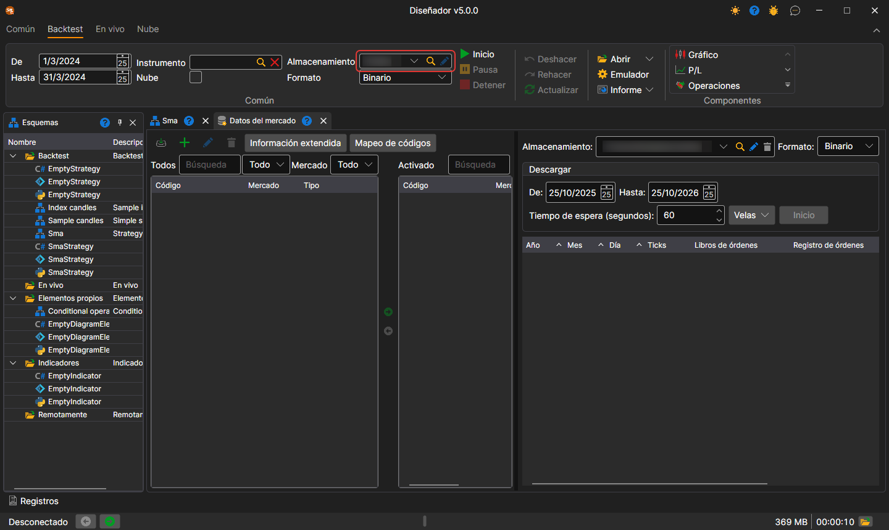

# Descargar datos de mercado

Para obtener los datos históricos del instrumento, seleccione el instrumento requerido en la lista **Todos los instrumentos** y muévalo a la lista de instrumentos **Activos**. Defina el período de datos históricos, seleccione el tipo y el marco temporal para las velas y haga clic en el botón **Iniciar**. Todos los datos se guardarán en el [Almacenamiento de datos de mercado](../market_data_storage.md).

Cuando termine la descarga, junto al botón **Inicio** aparecerá su resultado: **Hecho**, **Operación cancelada** o **Fallido** con la causa del error.

