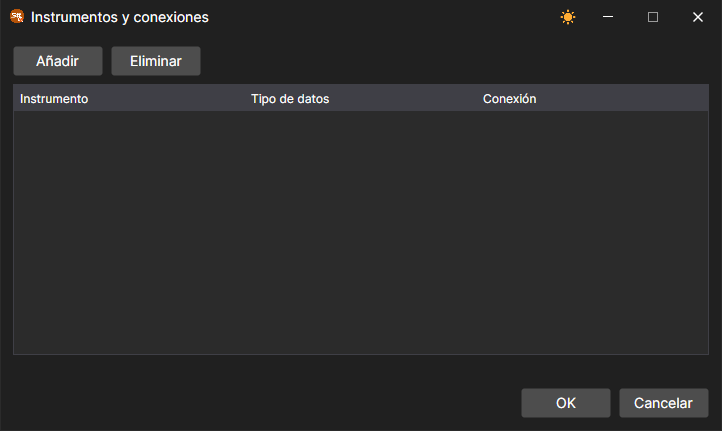

# Mapeo de símbolos

El mismo instrumento puede llamarse de forma diferente en distintos sistemas de negociación, y sus datos y órdenes pueden pasar por distintas conexiones. Para ello, [Designer](../../designer.md) tiene tres ventanas.

## Mapeo de códigos

El botón **Mapeo de códigos** del panel de datos de mercado abre la ventana **Códigos de instrumentos <\-> Códigos de adaptadores**. En la lista situada sobre la tabla se selecciona la conexión, el botón  añade una línea y el botón de eliminar quita la seleccionada. En las columnas **Código del instrumento** y **Código del mercado** se indica el instrumento tal como se llama en **Designer**, y en las columnas **Código en el adaptador** y **Código de mercado en el adaptador**, tal como lo llama la conexión seleccionada.

## Instrumentos y conexiones

La opción **Instrumentos y conexiones** de la lista desplegable del botón **Conectar** de la pestaña **Común** abre una ventana en la que, para un instrumento y un tipo de datos, se elige la conexión a través de la cual se reciben esos datos. El botón **Añadir** añade una línea en la que se rellenan las columnas **Instrumento**, **Tipo de datos** y **Conexión**; el botón **Eliminar** quita la línea seleccionada.

## Carteras y conexiones

La opción **Carteras y conexiones** de la misma lista abre una ventana igual para las carteras: en la columna **Cartera** se indica la cartera y en la columna **Conexión**, la conexión a través de la cual se envían sus órdenes.

En [Terminal](../../terminal.md) ambas ventanas se abren desde el menú **Configuraciones** del [menú principal](../../terminal/user_interface/ribbon.md).
