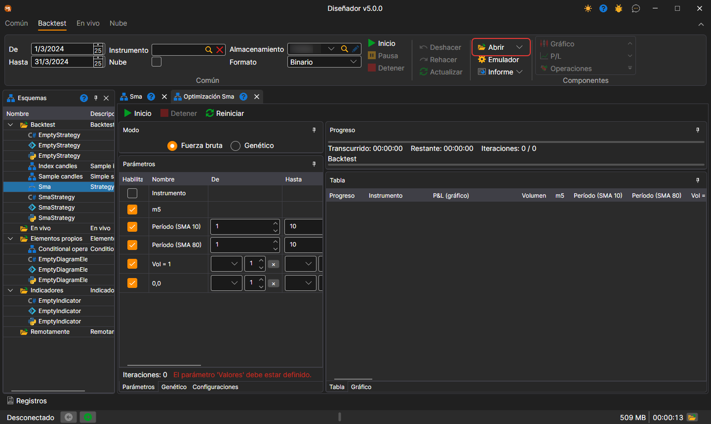
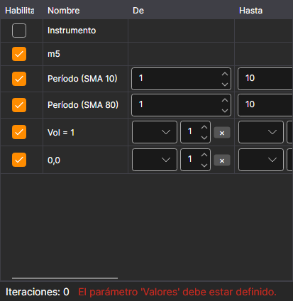
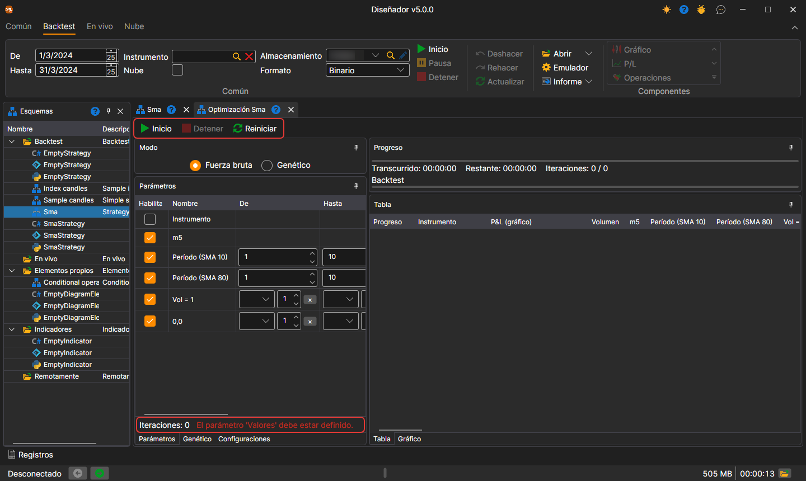

# Fuerza bruta

Para cambiar al modo de optimización de estrategia, en la pestaña **Backtest** abra la lista desplegable **Abrir** y seleccione **Optimización**. El ejemplo de optimización se considerará usando la estrategia SMA creada [a partir de cubos](../strategies/using_visual_designer/first_strategy.md).

Se abrirá una pestaña llamada Optimización + 'Nombre de la estrategia' en el espacio de trabajo. La pestaña **Optimización** está dividida en dos áreas: a la izquierda, qué y cómo optimizar; a la derecha, el resultado de la optimización:

- Arriba a la izquierda está **Modo**: **Fuerza bruta** o **Genético**. Debajo hay pestañas: **Parámetros**, con los parámetros de la estrategia que se [iteran](optimization_parameters.md); **Genético**, con la configuración de [Genética](genetic.md); **Configuraciones**, con la configuración de la emulación y del propio optimizador, por ejemplo, cuántas ejecuciones se realizan a la vez (**Paralelo**) y cuántas iteraciones se permiten (**Iteraciones**).
- A la derecha está **Progreso**: cuánto tiempo ha pasado, cuánto queda aproximadamente y cuántas iteraciones se han completado de las planificadas. Debajo están la pestaña **Tabla**, en la que cada fila es el resultado de probar la estrategia con parámetros únicos, y la pestaña **Gráfico**, que muestra los resultados en forma de [gráfico 3D](3d_chart.md).

Configurar los parámetros para iteración produce más de 1000 iteraciones. Después de iniciar el optimizador, el progreso en la parte superior sobre los resultados mostrará datos sobre el número planificado de iteraciones, cuántas ya se han completado y cuánto tiempo se necesita aproximadamente hasta la finalización:

## Tabla de parámetros y botones del panel

En la tabla de parámetros, cada fila muestra cuántos valores da con los valores **De**, **Hasta** y **Paso** indicados (columna **Conteo**) y qué está mal en ella (columna **Error**), por ejemplo, un paso con el que la iteración no llega al límite superior. Debajo de la tabla se indica cuántas ejecuciones dará la iteración de todos los parámetros juntos y el primer error, si lo hay.

Los botones **Inicio**, **Detener** y **Reiniciar** están directamente en el panel del optimizador y, debajo de ellos, está la barra de progreso de la ejecución actual. En la tabla de resultados hay una columna **Instrumento**, con el instrumento en el que se realizó la ejecución.

## Véase también

[Ejemplo de pruebas históricas](../backtesting/getting_started.md)
