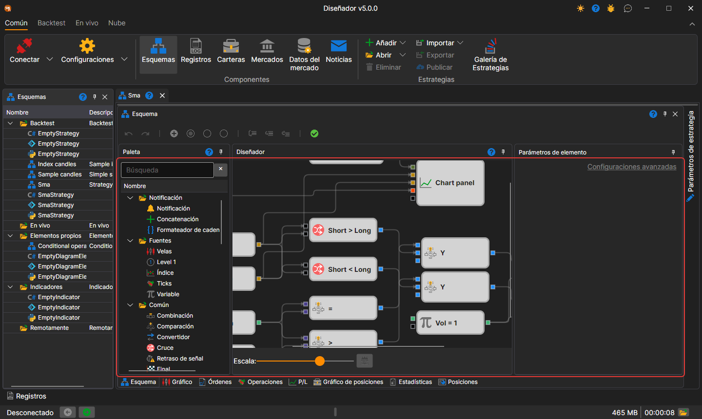
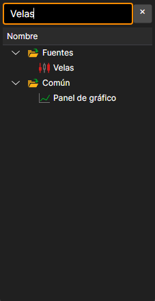
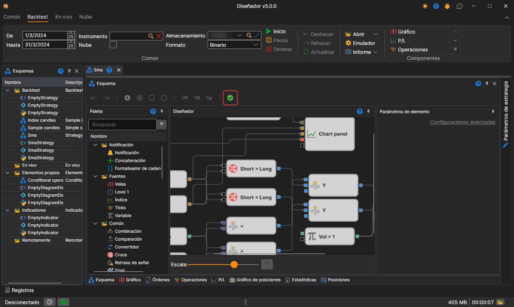
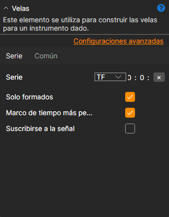
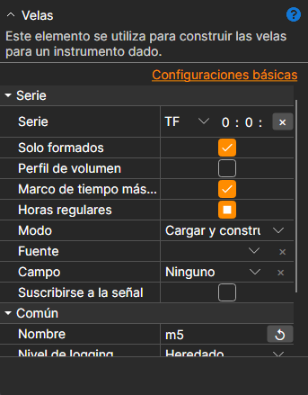

# Diseñador de estrategias

El proceso principal de diseño de una estrategia y sus elementos componentes se realiza en el panel **Esquema**, combinando bloques y líneas de conexión. El panel Esquema consta de los paneles **Paleta**, **Diseñador** y **Parámetros de elemento**.

## Panel Paleta

El panel **Paleta** contiene bloques a partir de los cuales se crean estrategias. Todos los elementos de la paleta están divididos en categorías, descritas en la sección [Descripción de bloques](elements.md). Para añadir un bloque al panel **Diseñador**, haga clic con el botón izquierdo en el bloque requerido y, sin soltar el botón, arrástrelo al panel **Diseñador**. Un doble clic en el bloque lo coloca en el centro del panel **Diseñador**. Después, el elemento se seleccionará automáticamente y sus parámetros se mostrarán en la ventana para editar las propiedades del bloque.

La línea de búsqueda situada encima de la paleta encuentra un bloque por su nombre, por su descripción y por el nombre de su categoría. La tecla **Enter** coloca en el panel **Diseñador** el bloque seleccionado o, si no hay ninguno seleccionado, el primero encontrado.

## Panel Diseñador

El panel **Diseñador** es donde ocurre todo el proceso de creación de una estrategia mediante la combinación de bloques y conexiones (líneas). Representa visualmente el esquema de la estrategia. La información detallada sobre la creación de una estrategia se describe en la sección [Creación de un algoritmo a partir de bloques](first_strategy.md).

Los bloques seleccionados se desplazan con las flechas del teclado: un paso o, con **Shift** pulsada, diez. Mientras se arrastra una línea de conexión, solo se resaltan los conectores a los que se puede conectar, y el extremo de la línea se ajusta por sí solo al más cercano.

La escala del esquema se cambia con el control deslizante **Escala** situado debajo del panel o con la rueda del ratón con **Ctrl** pulsada. Teclas del panel **Diseñador**:

| Teclas | Acción |
|---|---|
| **Ctrl+Z**, **Ctrl+Y** | deshacer y rehacer una acción |
| **Ctrl+C**, **Ctrl+X**, **Ctrl+V** | copiar, cortar y pegar los bloques seleccionados |
| **Ctrl+A** | seleccionar todos los bloques |
| **Delete** | eliminar lo seleccionado |
| **Esc** | quitar la selección o interrumpir el arrastre de una línea |
| **Ctrl+«+»**, **Ctrl+«−»** | aumentar y reducir la escala |
| **Ctrl+0** | volver a la escala original |
| **Ctrl+1** | ajustar todo el esquema al panel |
| **Alt+Z** | ajustar el esquema al panel o volver a la escala anterior |

El botón con una marca de verificación de la barra del esquema (su descripción emergente es **Validar el diagrama generando y compilando su código**) comprueba el esquema sin iniciar la estrategia. Si el esquema tiene un error, su texto se muestra en rojo sobre el panel **Diseñador**; allí también se muestran los errores del depurador.

## Panel Parámetros de elemento

El panel **Parámetros de elemento** muestra los parámetros del bloque seleccionado en el panel **Diseñador**. El bloque seleccionado se resalta con un marco.

El panel **Parámetros de elemento** puede mostrarse en dos modos: *Configuración básica* y *Configuración avanzada*.

De forma predeterminada, al construir un esquema, las propiedades se muestran inicialmente en modo *configuración básica*. Para cambiar al modo *configuración avanzada*, debe hacer clic en el título correspondiente.

En el modo *configuración básica*, solo se muestran las propiedades más necesarias del bloque. Por ejemplo, para el bloque [Velas](elements/data_sources/candles.md), se mostrará el marco temporal, la bandera para recibir solo velas formadas, la bandera de posibilidad de construir velas a partir de un marco temporal menor y la bandera de suscripción a velas por señal.

En el modo *configuración avanzada*, se mostrarán todas las propiedades del bloque disponibles para cambio y configuración.

Todos los bloques contienen un conjunto de propiedades predefinidas que se hacen visibles en el modo *configuración avanzada*:

- **Nombre** – nombre del elemento mostrado en el diseñador.
- **Nivel de registro** – nivel de registro para este elemento.
- **Parámetros** – mostrar los parámetros del elemento en elementos de nivel superior.
- **Conectores** – mostrar los conectores del elemento en elementos de nivel superior.

La información detallada sobre las propiedades de cada bloque se describe en la sección [Descripción de bloques](elements.md).

## Véase también

[Descripción de bloques](elements.md)
