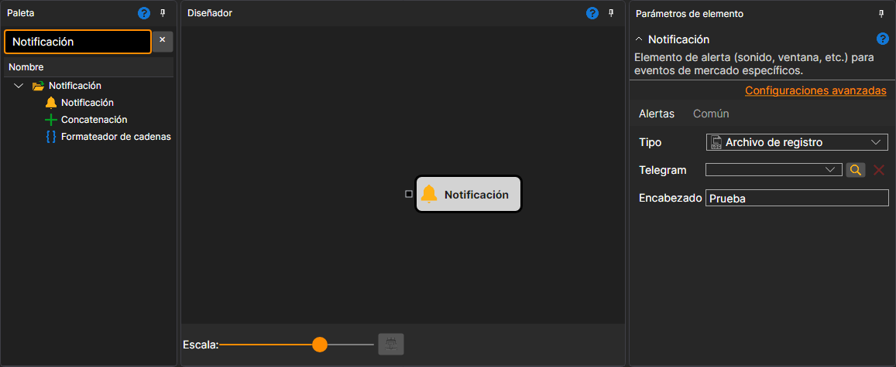

# Notificación

El cubo envía una notificación cuando llegan datos a su conector de entrada. El valor entrante se convierte en texto mediante `ToString`. Puede conectar una [Variable](../data_sources/variable.md) para enviar texto fijo, adjuntar flujos de operaciones o velas para ver sus detalles, o usar los cubos [Formato de cadena](string_format.md) y [Concatenación de cadenas](string_concat.md) para preparar un mensaje personalizado.

### Conectores de entrada

Conectores de entrada

- **Mensaje** - datos que se enviarán. Se acepta cualquier valor y se convierte en cadena.

### Parámetros

Parámetros

- **Tipo** - cómo enviar el mensaje: con un sonido, en una ventana emergente, en un archivo de registro o a Telegram. Los métodos se describen en la sección [Notificaciones](../../../../../terminal/notifications.md).
- **Telegram** - canal usado para notificaciones de Telegram.
- **Encabezado** - encabezado del mensaje.

## Contenido recomendado

[Formato de cadena](string_format.md)
[Concatenación de cadenas](string_concat.md)
[Notificaciones](../../../../../terminal/notifications.md)
