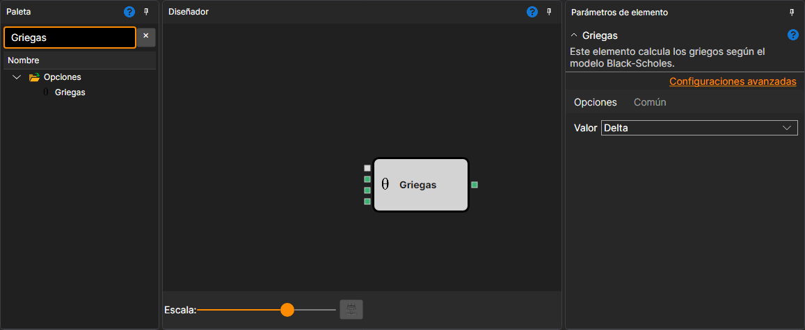

# Griegas

Este bloque se usa para calcular las principales "griegas": Delta, Gamma, Vega, Theta y Rho en el momento actual.

### Conectores de entrada

Conectores de entrada

- **Modelo** – modelo de cálculo (por ejemplo, Black-Scholes).
- **Precio del activo subyacente** – precio del activo subyacente.
- **Desviación máxima** – desviación máxima.
- **Prima** – precio de la opción. Con él, el bloque encuentra la volatilidad implícita cuando **Valor** es IV; para los demás valores no es necesario.

### Conectores de salida

Conectores de salida

- **Resultado** – resultado del cálculo de las principales "griegas": Delta, Gamma, Vega, Theta y Rho en el momento actual.

### Parámetros

Parámetros

- **Valor** – puede tomar el tipo de "griega" Delta, Gamma, Vega, Theta o Rho, así como Prima (precio de la opción según el modelo) e IV (volatilidad implícita en porcentaje según la entrada **Prima**), y determina qué valor se emitirá desde el bloque.

## Véase también

[Black-Scholes](black_scholes.md)
