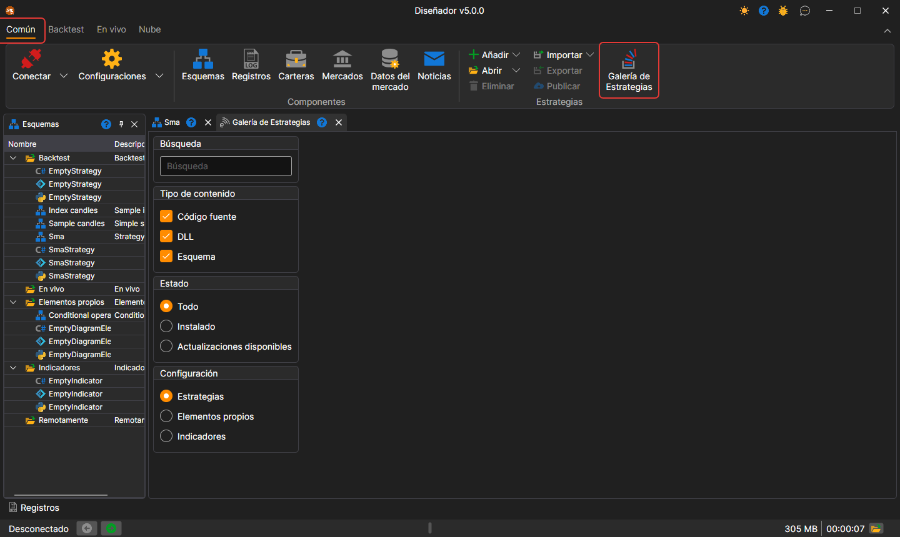
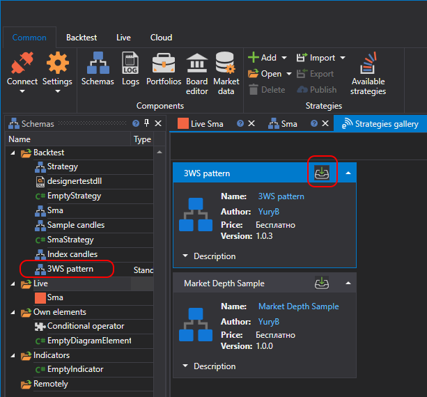

# Galería de estrategias

La **Galería de estrategias** ofrece la posibilidad de descargar estrategias de negociación listas para usar en su ordenador. Puede abrir la **Galería de estrategias** haciendo clic en el botón **Galería de estrategias** de la pestaña **Común**.

Las tarjetas de estrategias aparecen a medida que el catálogo se lee desde el sitio web y, mientras dura la lectura, el panel muestra el texto **Cargando estrategias desde la galería...**. Si no se pudo leer el catálogo, el panel muestra la causa y el botón **Actualizar**, que repite la carga.

Para descargar una estrategia a su ordenador, debe:

- seleccionar la estrategia de interés y hacer clic en el botón Descargar:

  

- la estrategia se añadirá al árbol de estrategias en la sección **Backtest**:

  

## Véase también

[Publicar su estrategia](strategy_gallery/publish_own_strategy.md)
