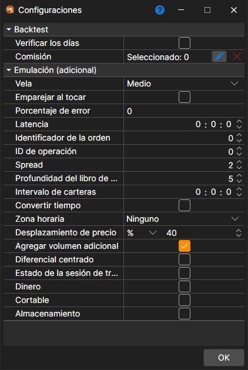

# Configuración de pruebas históricas

La configuración de la emulación se abre con el botón **Emulador** de la pestaña **Backtest** de la cinta cuando hay abierta una estrategia para la prueba sobre historial o para la optimización. Al seleccionar una propiedad, en la parte inferior de la ventana aparece su descripción detallada. Las propiedades están agrupadas:

**Backtest**

- **Verificar los días** – comprobar si los días cargados son días de negociación.
- **[Comisión](../commissions.md)** – comisión (corretaje, bolsa, etc.).

**Emulación (adicional)**

- **Vela** – a qué precio de la vela se ejecutan las órdenes cuando la prueba se realiza con velas: medio, apertura, máximo, mínimo o cierre.
- **Combinar al tocar** – durante la emulación, combinar órdenes cuando el precio de la operación toca el precio de la orden (es decir, es igual al precio de la orden).
- **Porcentaje de errores** – valor porcentual del error al registrar nuevas órdenes. El valor puede ser de 0 (no habrá errores) a 100.
- **Latencia** – valor mínimo de latencia de la orden registrada.
- **ID de orden** – número desde el que el emulador generará identificadores de órdenes.
- **ID de operación** – número desde el que el emulador generará identificadores de operaciones.
- **Spread** – tamaño del spread en pasos de precio. Se usa al especificar el spread para generar un libro de órdenes a partir de operaciones tick.
- **Profundidad del libro** – profundidad máxima del libro de órdenes que se generará a partir de ticks.
- **Intervalo de carteras** – intervalo de recálculo de cartera. Si el intervalo es cero, no se realiza recálculo.
- **Cambiar hora** – cambiar la hora de órdenes y operaciones a hora de la bolsa.
- **Zona horaria** – zona horaria de la bolsa.
- **Desplazamiento de precio** – desplazamiento de precio desde la última operación, que especifica los límites de precios máximo y mínimo para la siguiente sesión.
- **Añadir volumen extra** – añadir volumen extra al libro de órdenes al registrar órdenes de gran volumen.
- **Diferencial centrado** – repartir el spread por igual alrededor de los precios para los que no se sabe qué lado operó (por ejemplo, los precios de las velas), de modo que la compra y la venta paguen la misma mitad del spread.
- **Estado de la sesión de negociación** – comprobar el estado de negociación.
- **Dinero** – comprobar el saldo monetario.
- **Cortable** – si se pueden abrir posiciones cortas.
- **Almacenamiento** – permitir guardar los mensajes que crea el emulador.

El período de prueba, el instrumento, el almacenamiento de datos de mercado y su formato se definen en la propia pestaña **Backtest** ([Interfaz](../../backtesting/user_interface.md)), y los parámetros del esquema, en el panel **Parámetros de estrategia** junto al borde derecho de la pestaña de estrategia.

## Contenido recomendado

[Gráfico](chart.md)
