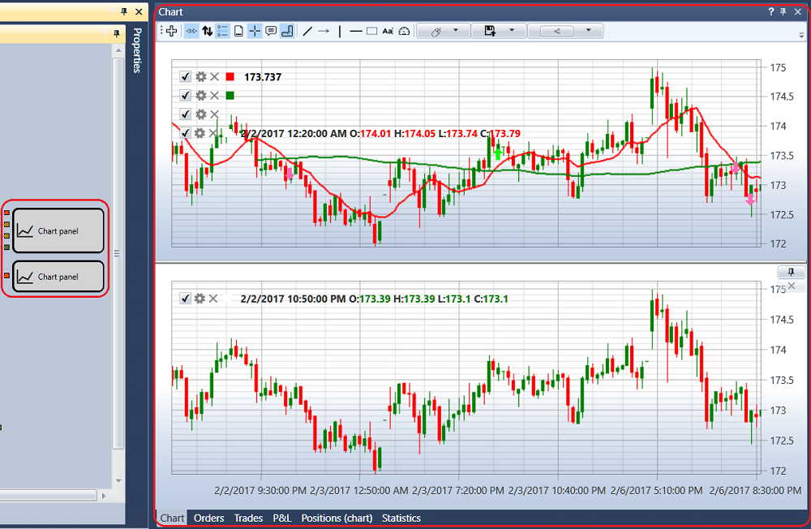
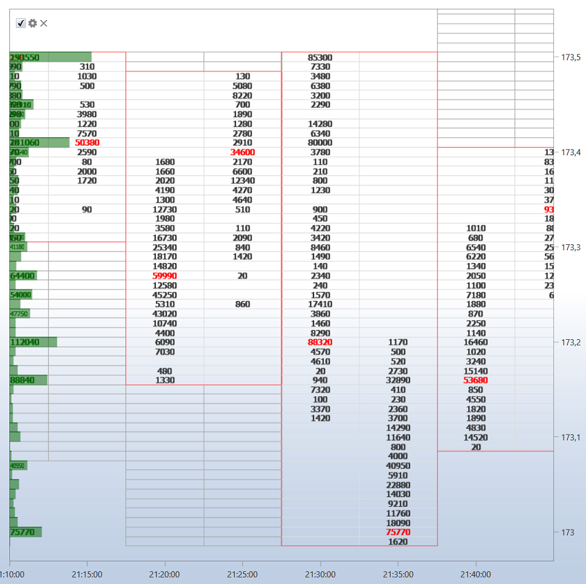

# Gráfico

El componente **Gráfico** contiene todos los cubos **Panel de gráfico** que están en la estrategia. Por ejemplo, si la estrategia usa dos cubos **Panel de gráfico**, en el componente **Gráfico** se muestran 2 gráficos, como en la figura.

La esquina superior izquierda de cada gráfico muestra todos los elementos gráficos añadidos al gráfico. Si desmarca la casilla del elemento gráfico , el elemento se eliminará del gráfico. Al hacer clic en el botón , se abrirá la configuración del elemento gráfico. También puede configurar el elemento gráfico en las propiedades del cubo [Gráfico](../../strategies/using_visual_designer/elements/common/chart.md).

En la configuración del elemento gráfico, puede establecer el estilo de gráfico requerido: velas japonesas, barras, gráfico Box, perfil de clúster, etc.

Para un gráfico Box, las velas pueden agruparse adicionalmente; el orden de agrupación se establece en los campos: multiplicador del segundo marco temporal, multiplicador del tercer marco temporal.

El botón **Portapapeles (como imagen)** de la barra de botones copia la imagen del gráfico para pegarla en un mensaje o un documento. Un clic derecho en la propia barra de botones abre la lista de sus botones: la casilla desmarcada oculta el botón y la marcada lo vuelve a mostrar; los botones que se muestran se guardan junto con el gráfico. La ventana de configuración del gráfico, la cruz y las teclas de desplazamiento y escala se describen en la sección [Gráfico](../../../terminal/user_interface/components/chart.md) de Terminal.

Encima del gráfico hay una barra de herramientas donde puede seleccionar desplazamiento automático, zoom automático, modos de leyenda y otros ajustes generales del gráfico. También puede seleccionar los elementos que se dibujarán en el gráfico: líneas, niveles, punteros, rectángulo, texto.

## Contenido recomendado

[Órdenes](orders.md)
