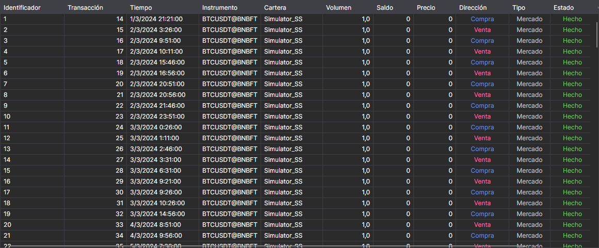

# Órdenes

El componente **Órdenes** es una tabla con órdenes que muestra información completa sobre todas las órdenes de la estrategia.

La lista situada sobre la tabla elige qué órdenes mostrar: **Todo**, solo las activas (**Activo**), las ejecutadas (**Hecho**) o las rechazadas (**Fallido**).

Cómo copiar las filas de la tabla, buscarlas y filtrarlas, y configurar las columnas se describe en la sección [Trabajo con tablas](../../../terminal/user_interface/tables.md).

## Contenido recomendado

[Operaciones](trades.md)
