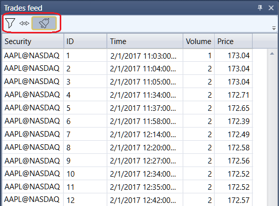

# Operaciones tick

El componente **Flujo de operaciones** es una tabla con operaciones que muestra información completa sobre todas las operaciones de los instrumentos seleccionados.

El **Flujo de operaciones** tiene un filtro para seleccionar los instrumentos necesarios.

