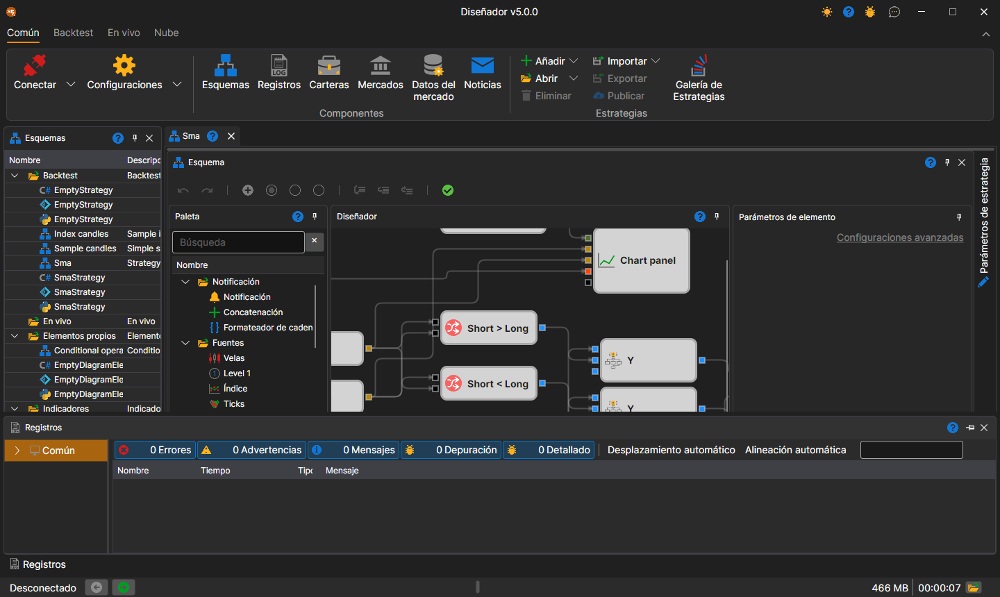

# Espacio de trabajo

El **Área de trabajo** en [Designer](../../designer.md) es una interfaz de ventanas con acoplamiento de paneles similar a la usada en Microsoft Visual Studio. Al hacer clic en el encabezado del panel con el botón izquierdo del ratón y mantenerlo pulsado, puede fijar el panel en un lugar conveniente. Arrastrando los bordes del panel puede ajustar su altura o anchura:

En la parte inferior de la ventana está la barra de estado: si [Designer](../../designer.md) está conectado (**Desconectado**, **Conectado** o el texto del error de conexión), las noticias de StockSharp, los contadores de advertencias y errores del registro, el último mensaje del registro (un clic en él abre el [Panel de registros](logs.md)), la memoria ocupada, el tiempo de funcionamiento y el botón de la carpeta de registros. Estas partes se describen con más detalle en la sección [Barra de estado](../../terminal/user_interface/status_bar.md) de Terminal.

## Contenido recomendado

[Esquemas](schemas.md)
