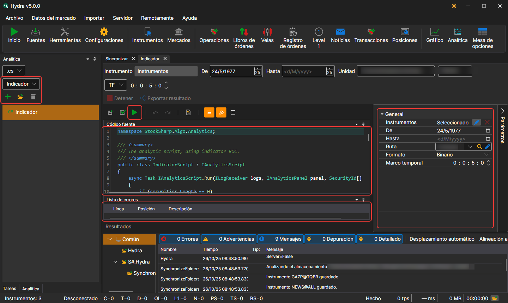
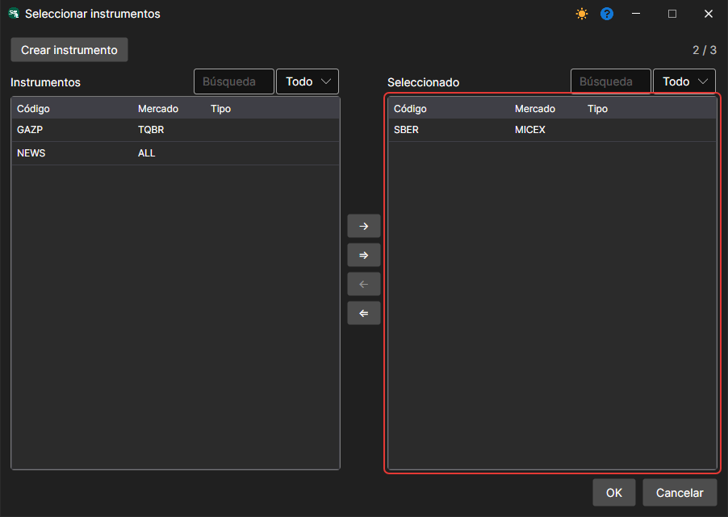

# Ejecución de un script

Para crear un nuevo script analítico, abra la pestaña **Analítica** del panel izquierdo, elija el lenguaje del script y la plantilla para un inicio rápido y pulse **Añadir**. El script se abrirá en una pestaña aparte:

La captura muestra la interfaz principal de esta función, compuesta por varios componentes clave:

- **Panel «Analítica»**: a la izquierda se eligen el lenguaje y la plantilla del nuevo script (volumen intradía, perfil de volumen, gráficos, indicadores y otras herramientas de análisis); debajo están los botones con iconos **Añadir**, **Abrir** y **Eliminar** (el nombre del botón se ve en la descripción emergente) y la lista de scripts creados.
- **Parámetros de inicio y botones**: encima del código se definen los instrumentos, el período, el almacenamiento, el formato y el marco temporal, y con los botones se ejecutan **Guardar fuente**, **Referencias** (ensamblados y paquetes a los que hace referencia el script), **Compilar y ejecutar fuente**, **Detener** y **Exportar resultado**.
- **Ventana de código**: muestra el código fuente del script analítico seleccionado. Los usuarios pueden editar directamente el código para personalizar o crear cálculos y estrategias analíticas.
- **Panel de parámetros**: a la derecha, se despliega con el botón **Parámetros**; en él se definen los parámetros de los scripts analíticos, incluyendo selección de instrumentos, período de análisis, ruta de datos y otros ajustes.
- **Lista de errores**: en la parte inferior de la interfaz hay una lista de errores detectados durante la compilación o ejecución del script analítico.

El script analítico se formatea como una clase heredada de [IAnalyticsScript](xref:StockSharp.Algo.Analytics.IAnalyticsScript).

Al configurar parámetros:

- **Instrumento** puede establecerse de uno a varios instrumentos, según la lógica del script.

- El rango de fechas.
- El almacenamiento desde el que obtener los datos.
- El marco temporal de trabajo del script, si utiliza uno.

Al hacer clic en el botón , el script se compilará y se ejecutará, y los resultados de su ejecución se abrirán en una nueva pestaña.
