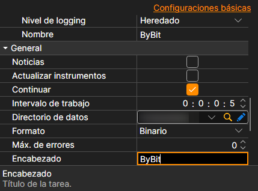

# Configuración común de conexión

Propiedades de conexión comunes a todas las fuentes.

**General**

Los ajustes propios de cada fuente van primero: claves, direcciones, reconexión. Les siguen los comunes a todas las fuentes:

- **Noticias** - descargar noticias.
- **Actualizar instrumentos** - actualizar instrumentos al conectarse.
- **Continuar** - continuar la descarga desde la última fecha descargada.
- **Intervalo de trabajo** - intervalo de trabajo.
- **Directorio de datos** - directorio con los datos donde se guardarán los archivos finales en formato StockSharp.
- **Formato** - formato de datos: BIN\/CSV.
- **Máx. errores** - número máximo de errores tras el cual la tarea se detendrá. El valor predeterminado es 0, lo que significa ignorar la cantidad de errores.
- **Título** - nombre de la tarea.
- **Horario laboral** - horario de trabajo de la tarea.
- **Validación** - qué hacer con los datos que no superan la validación: nada, eliminarlos o detener la suscripción.

**Remotamente**

- **Habilitado** - controlar la tarea de forma remota.
- **Notificación** - canal al que llegan las notificaciones sobre la tarea.
- **Nivel de registro** - qué mensajes de la tarea se envían al canal.
