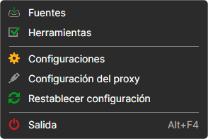
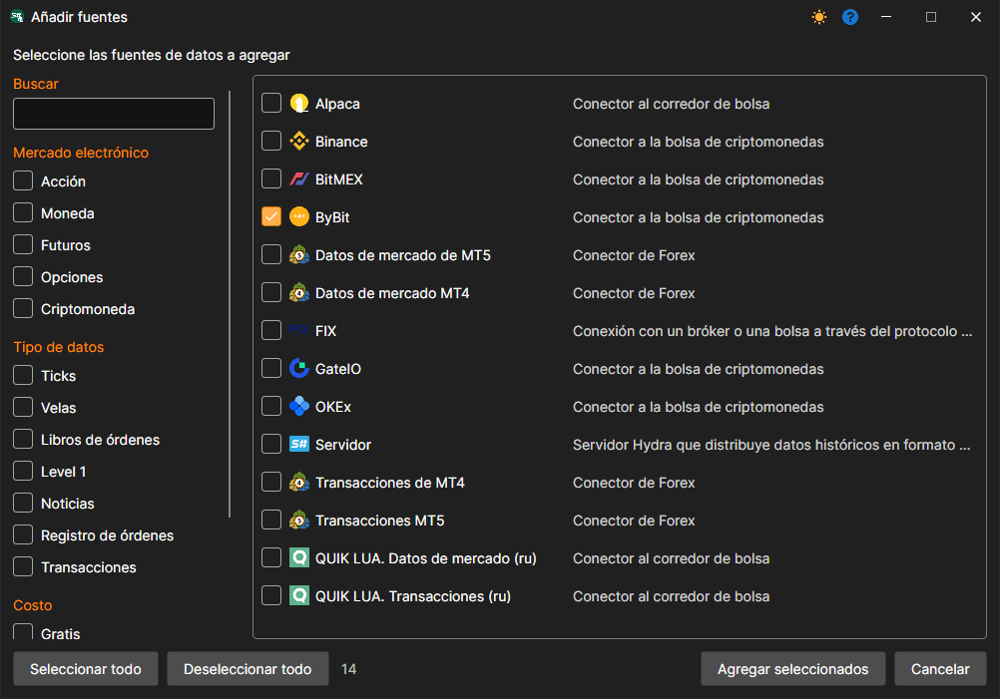
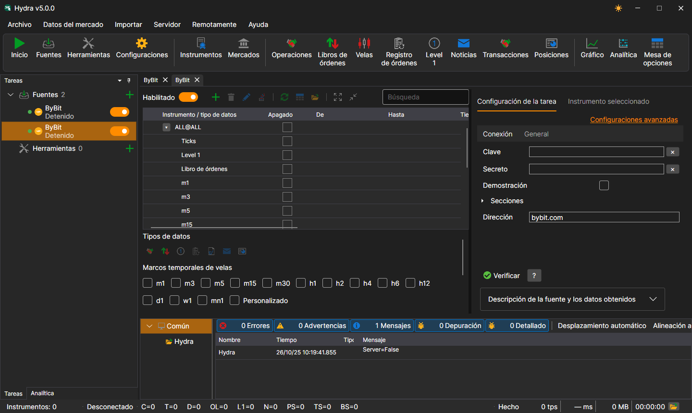
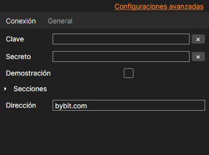

# Seleccionar fuente

Para añadir una nueva fuente de datos de mercado, abra el menú **Archivo** y seleccione la opción **Fuentes**, o pulse el botón **Fuentes** de la barra de herramientas.

Se abrirá la lista de fuentes. Se pueden marcar varias a la vez (con un clic en la casilla o en el nombre) y pulsar **Agregar seleccionados**.

También se pueden añadir varias instancias de la misma fuente, por ejemplo, dos **ByBit** con claves diferentes o con carpetas diferentes para los datos descargados. Cada instancia es una tarea aparte en el panel **Tareas**. Para distinguirlas sirve el **Título** de la pestaña **General** de la configuración de la fuente.

Para que la fuente descargue datos después de hacer clic en el botón **Inicio**, debe estar habilitada. Para ello sirve el interruptor : lo tiene cada fuente en el panel **Tareas** y también está encima de la tabla de instrumentos de la fuente (**Habilitado**). La fuente se puede habilitar antes o después de añadir instrumentos.

Una fuente innecesaria se elimina con el comando **Eliminar** del menú contextual de la fuente en el panel **Tareas**.

La configuración de la fuente está en la pestaña **Configuración de la tarea**, a la derecha de la tabla de instrumentos. En la pestaña **Conexión** está lo imprescindible para que la fuente se conecte: claves, dirección, etc.; en la pestaña **General**, el resto. El enlace **Configuraciones avanzadas** muestra todos los parámetros de la fuente, no solo los principales.

La configuración común para todas las fuentes se encuentra en la sección [Configuración común de conexión](common_connection_settings.md).

Cada conexión tiene sus propias características. El enlace [Lista de conectores](../data_sources.md) contiene una lista de conectores y sus ajustes.

**Ver [tutorial en video](../videos/sources_samples.md)**
