# Primer inicio

Al iniciarse por primera vez, Hydra propone elegir las fuentes de datos. Más adelante, esta misma ventana se abre con el botón **Fuentes** de la barra de herramientas o desde el menú **Archivo**.

Marque las fuentes necesarias: se puede hacer clic tanto en la casilla como en el nombre. Los filtros de la izquierda reducen la lista: mercado electrónico, tipo de datos, coste; el campo **Buscar** busca por nombre. Como ejemplo, marquemos **ByBit** y pulsemos **Agregar seleccionados**.

A continuación se abrirá una ventana igual con las utilidades, tareas que no descargan datos, sino que trabajan con los ya descargados: importación y exportación programadas, conversión, copia de seguridad en la nube. Más información sobre ellas en la sección [Utilidades](tasks.md). Si de momento no necesita utilidades, pulse **Cancelar**.

Para cada fuente añadida, Hydra preguntará si desea habilitarla ahora. Una fuente habilitada descarga datos cuando se pulsa el botón **Inicio**; una deshabilitada se omite. Responda **Sí**.

La fuente aparecerá en el panel **Tareas** de la izquierda y en el centro se abrirá su panel: la tabla de instrumentos; debajo, la configuración de los datos que se reciben, y a la derecha, la configuración de conexión.

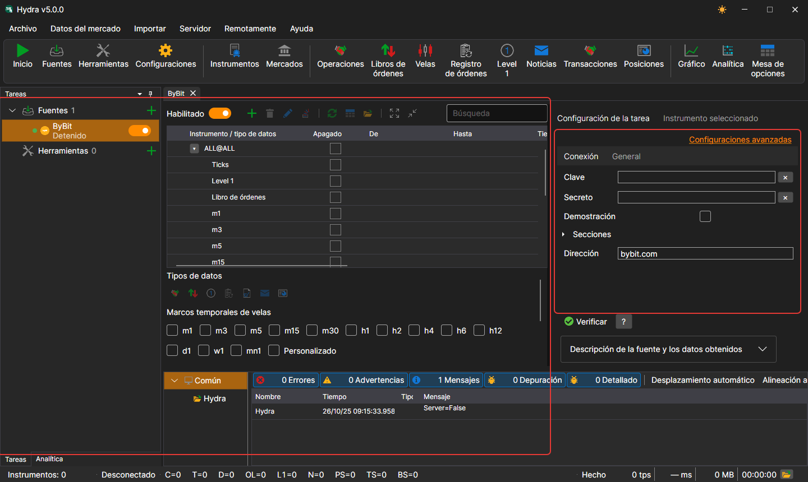

## Instrumentos

> [!TIP]
> Los datos se descargan solo para los instrumentos añadidos a la fuente.

Justo después de añadirla, la fuente solo tiene el instrumento auxiliar **ALL@ALL**, «todos los instrumentos de la fuente». Con él se descargan los datos que la fuente puede entregar a la vez para todos sus instrumentos. Como ejemplo, añadamos el par al contado BTCUSDT.

1. Pulse el botón **Agregar instrumentos**  encima de la tabla de instrumentos. Se abrirá la ventana de selección: a la izquierda, los instrumentos que conoce Hydra; a la derecha, los seleccionados para la fuente.

   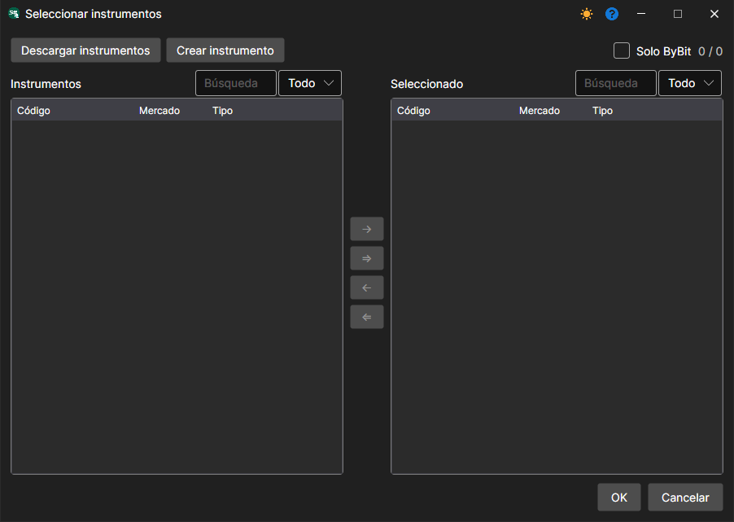

2. La primera vez la lista de la izquierda está vacía: Hydra todavía no conoce ningún instrumento. Pulse **Descargar instrumentos**. En la ventana que se abre se definen las condiciones de búsqueda; la casilla **Todo** solicita a la fuente la lista completa.

   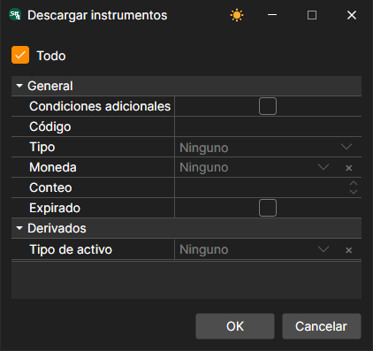

   Para algunas fuentes, en lugar de la lista completa se pueden [indicar](prepare_for_download/instruments_list.md) los instrumentos necesarios.

3. Pulse **OK**. Cuando la fuente responda, Hydra informará de cuántos instrumentos nuevos se han añadido, y estos aparecerán en la lista de la izquierda. El contador situado encima de la lista muestra cuántos instrumentos se ven y cuántos se conocen en total; la casilla **Solo ByBit** oculta los instrumentos que ya descargan otras fuentes.

   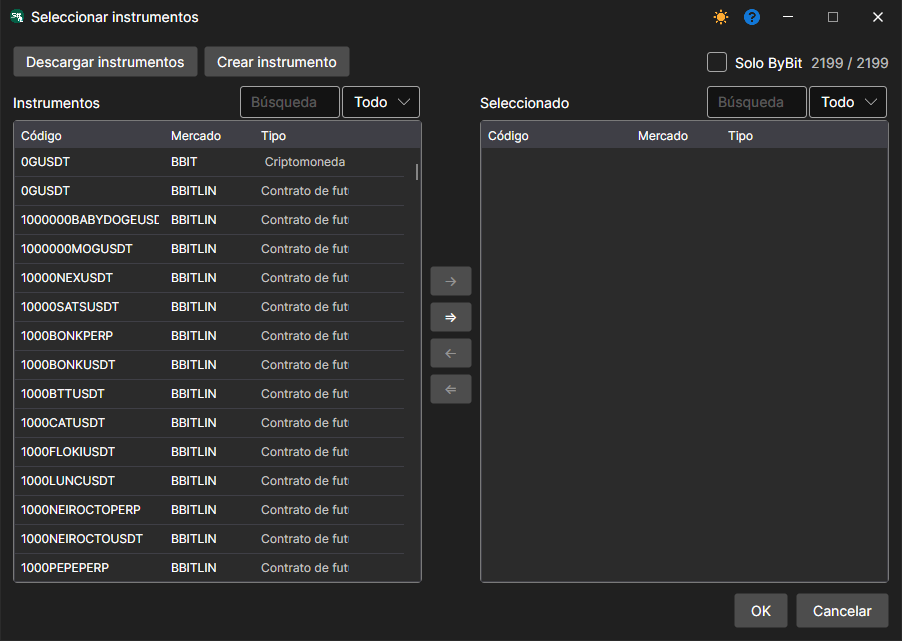

4. Empiece a escribir el código del instrumento en el campo **Búsqueda** situado encima de la lista.

   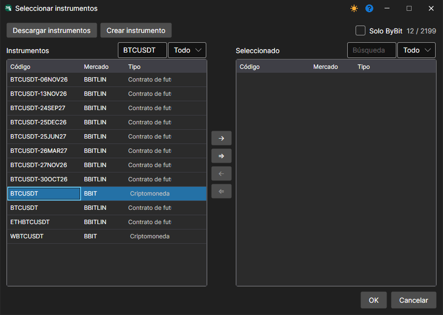

5. Pase el instrumento a la derecha con un doble clic o con el botón de la flecha y pulse **OK**.

   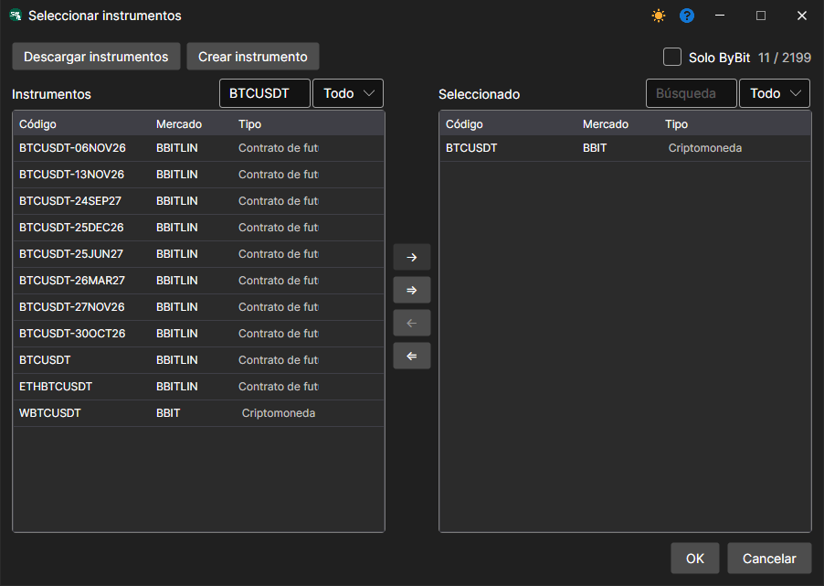

## Tipos de datos y período

Después de seleccionar los instrumentos, Hydra preguntará qué datos descargar para ellos. Marquemos **Ticks** y las velas de cinco minutos **TF: 00:05:00**; cada clic añade un tipo más a la selección.

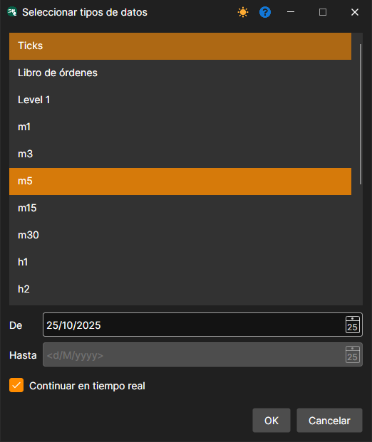

La fecha **De** es el inicio del historial. La casilla **Continuar en tiempo real** hace que la fuente siga recibiendo datos después de descargar el historial; con ella no se necesita la fecha **Hasta**. Cuánto historial entrega la fuente depende de la propia fuente.

Después de **OK**, el instrumento aparecerá en la tabla de la fuente. La tabla es jerárquica: en la fila del instrumento está su código y, debajo, los tipos de datos seleccionados con las fechas de inicio y fin.

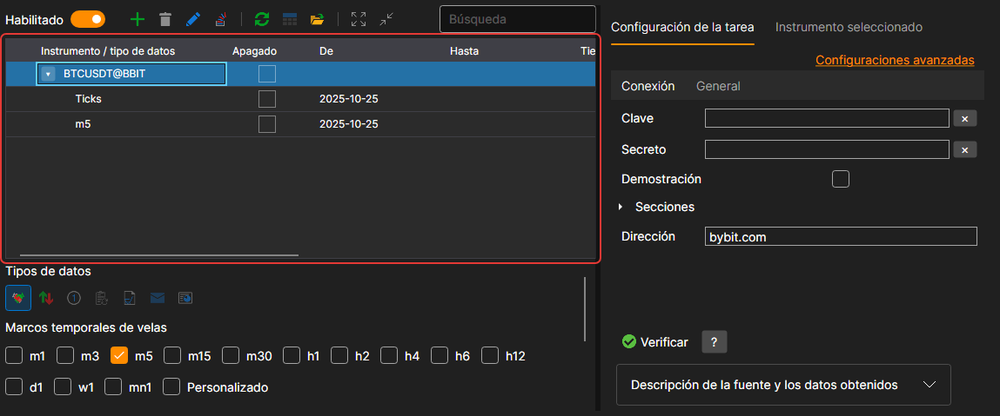

Si para un instrumento no se ha seleccionado ningún tipo de datos o no tiene definidos el paso de precio, el paso de volumen o el número de decimales, a la izquierda de su fila aparece el icono ⚠. La descripción emergente del icono explica qué falta.

Debajo de la tabla está la configuración de las filas seleccionadas en ella. Seleccione una o varias filas y la configuración se aplicará a todas a la vez:

- **Tipos de datos**: qué datos recibir. El conjunto depende de la fuente.

  

- **Marcos temporales de velas**: qué velas descargar. La lista de marcos temporales también depende de la fuente; **Personalizado** abre una ventana en la que se define un [tipo de vela propio](prepare_for_download/custom_candles.md).

  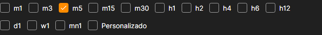

- **De** y **Hasta**: período de descarga. Sin fecha de fin, la fuente descarga todo lo que hay hasta hoy y, si puede trabajar en tiempo real y está marcada la casilla **Tiempo real**, sigue recibiendo datos después.

  **Construcción de velas**: de dónde se toman las velas: **Cargar**, ya hechas desde la fuente; **Construir**, las construye el propio Hydra; **Cargar y construir**, se cargan y las que faltan se construyen. **Campo de construcción**: a partir de qué se construyen: del precio de la última operación, del punto medio del spread, del mejor precio, etc. Construir velas es útil cuando la fuente no las entrega en el marco temporal necesario.

  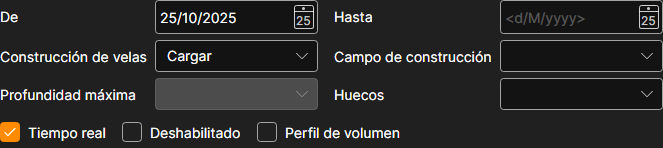

## Descarga

Pulse **Inicio** en la barra de herramientas. La fuente se conectará y empezará la descarga. El progreso se ve en el panel **Registros** de la parte inferior de la ventana, y la barra de estado cuenta los datos recibidos: **C**, velas; **T**, ticks, etc. Los registros también se guardan en archivos en la carpeta de Hydra.

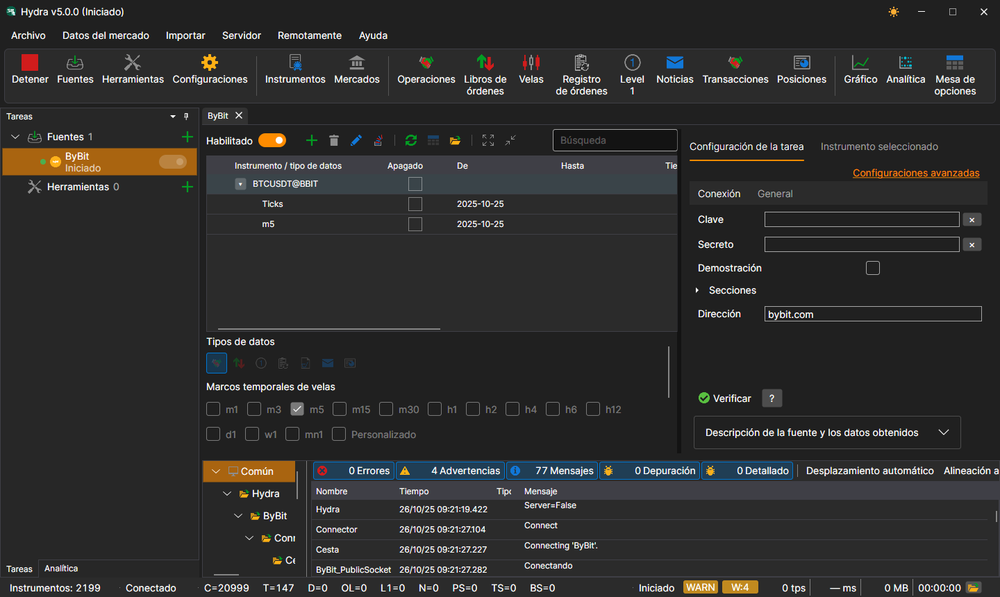

También puede añadir [otras fuentes](data_sources/select_source.md).

Los datos descargados se pueden [ver](working_with_data/view_and_export.md), con ellos se pueden [construir velas](working_with_data/candles_generation.md) y se pueden [exportar](working_with_data/export_data.md) a distintos formatos.

**Ver [tutorial en video](videos/first_start.md)**.
