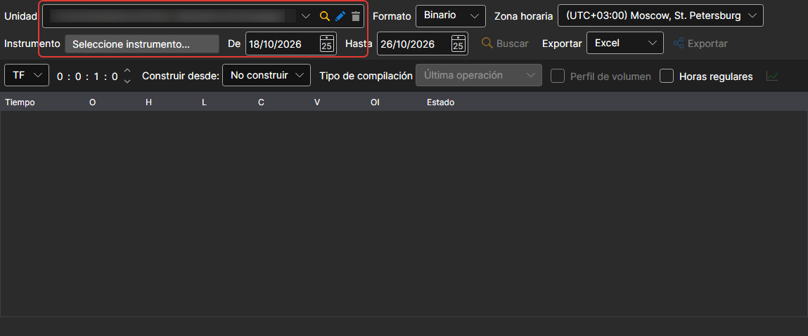
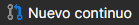
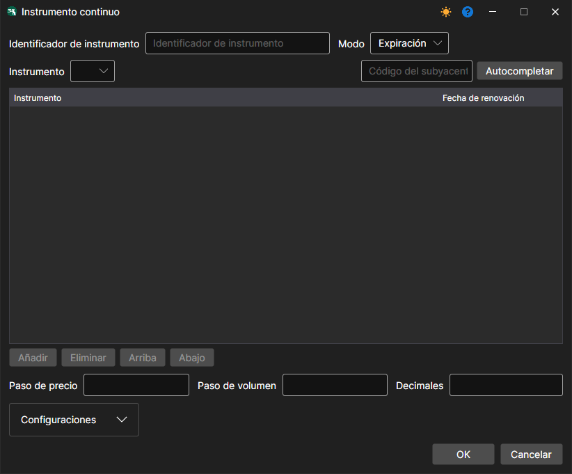
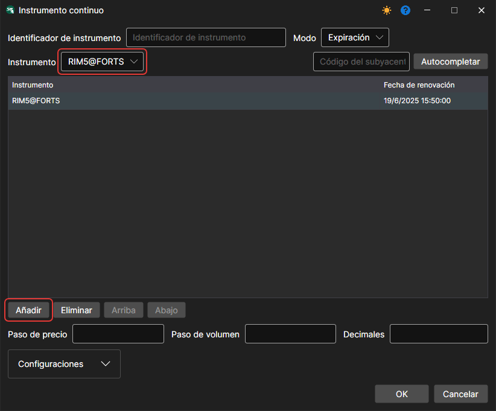
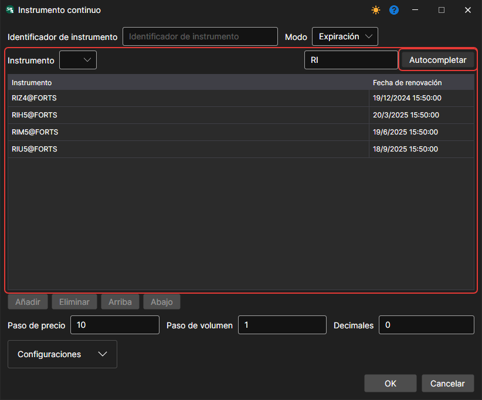
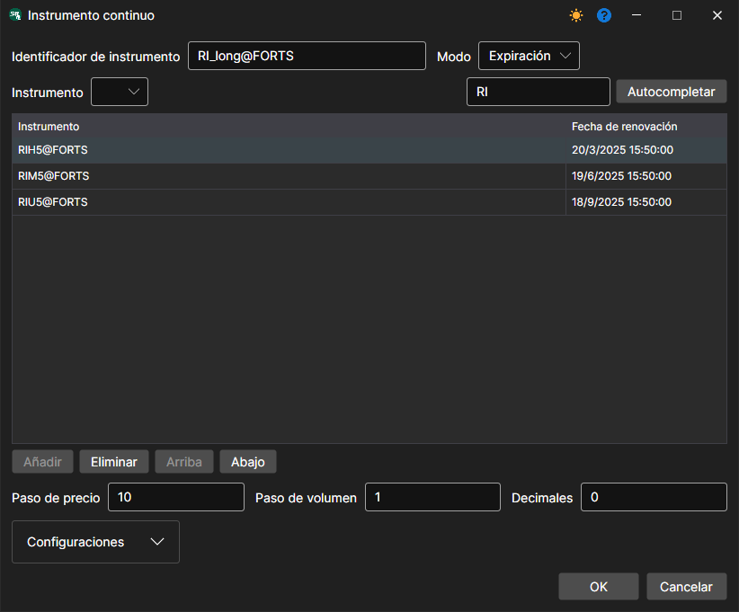
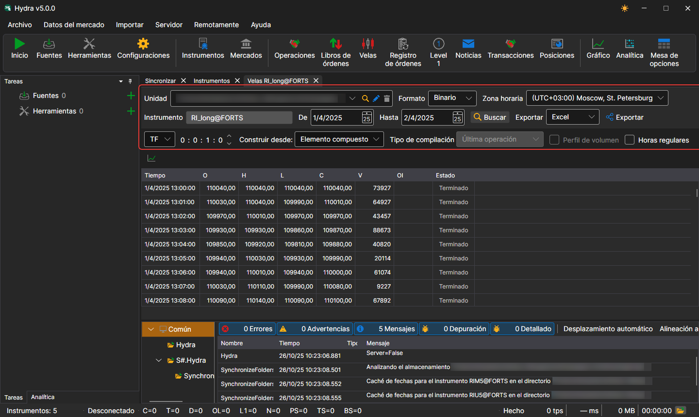

# Futuros continuos

El programa [Hydra](../../hydra.md) permite al usuario combinar distintos tipos de datos de mercado de varios contratos en un único instrumento continuo.

Para ello, en el menú **Datos del mercado** seleccione la opción **Instrumentos**; aparecerá el panel **Instrumentos**. Antes de combinar los datos, compruebe qué datos de mercado están disponibles. Seleccione la ruta donde se encuentran los datos y revise los instrumentos que planea combinar. Si hay huecos, descargue los datos de mercado faltantes (por ejemplo, desde una fuente de datos compatible).

Como ejemplo, consideremos la combinación de futuros E-mini S&P 500.

1. Para crear un contrato de futuros continuo, en el panel **Instrumentos** haga clic en el botón **Nuevo continuo**.

   Después aparecerá la siguiente ventana:
2. Para crear un futuro continuo, debe especificar un nombre y añadir contratos.

   Hay dos formas de añadir contratos.
   - Manualmente: seleccione el contrato en la lista **Instrumento** y haga clic en el botón **Añadir**.
   - Si en el campo **Código del subyacente** introduce las dos primeras letras del contrato, por ejemplo RI, y hace clic en el botón **Autocompletar**, se añadirán todos los contratos encontrados en la base de datos con sus fechas de vencimiento.
3. Seleccione los contratos necesarios y establezca sus fechas de transición. 
4. Después, asigne el identificador de instrumento **RI\_long@FORTS** y haga clic en el botón **Aceptar**; se creará un nuevo instrumento.
5. Luego seleccione la opción [Velas](../working_with_data/view_and_export/candles.md) del menú **Datos del mercado**, seleccione el instrumento resultante y el período de datos, establezca el valor **Elemento compuesto** en el campo **Construir desde** y haga clic en el botón . 

Los datos generados se pueden exportar a formatos Excel, XML, JSON o TXT. La exportación se realiza mediante la lista desplegable.

