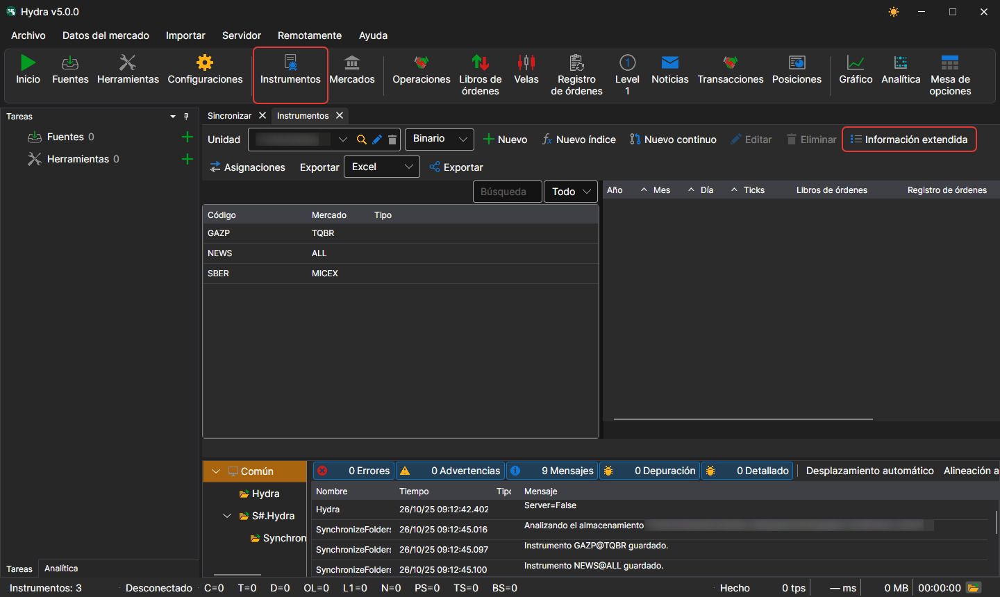
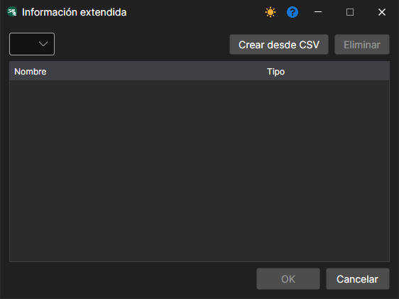

# Información extendida del instrumento

Las fuentes de información extendida son archivos **CSV** ubicados en la carpeta `c:\\Users\\Users\\Documents\\StockSharp\\Hydra\\Extended info\\`. Se cargan automáticamente al iniciar [Hydra](../../hydra.md).

La información extendida puede incluir cualquier detalle adicional sobre un instrumento (por ejemplo, país, ciudad, mercado, etc.).

Cada fuente de información extendida (archivo CSV) contiene una lista de instrumentos y las propiedades disponibles. Para cada fuente, la información extendida es única.

Si la fuente no contiene información extendida para un instrumento, las columnas correspondientes de la lista de instrumentos estarán vacías.

Para seleccionar la información extendida necesaria, debe:

1. En el panel **Instrumentos**, hacer clic en el botón **Información extendida**
2. Aparecerá una ventana en la que debe seleccionar la ruta al archivo CSV requerido

A continuación se muestra un ejemplo de archivo **CSV** de información extendida. Los valores se separan con punto y coma: la primera línea contiene los nombres de las propiedades, la segunda, sus tipos, y cada una de las siguientes, el identificador del instrumento y los valores de sus propiedades:

```
SecurityId;Country;City;Site
string;string;string;string
SBER@TQBR;Rusia;Moscú;www.sberbank.ru
GAZP@TQBR;Rusia;San Petersburgo;www.gazprom.ru
```
