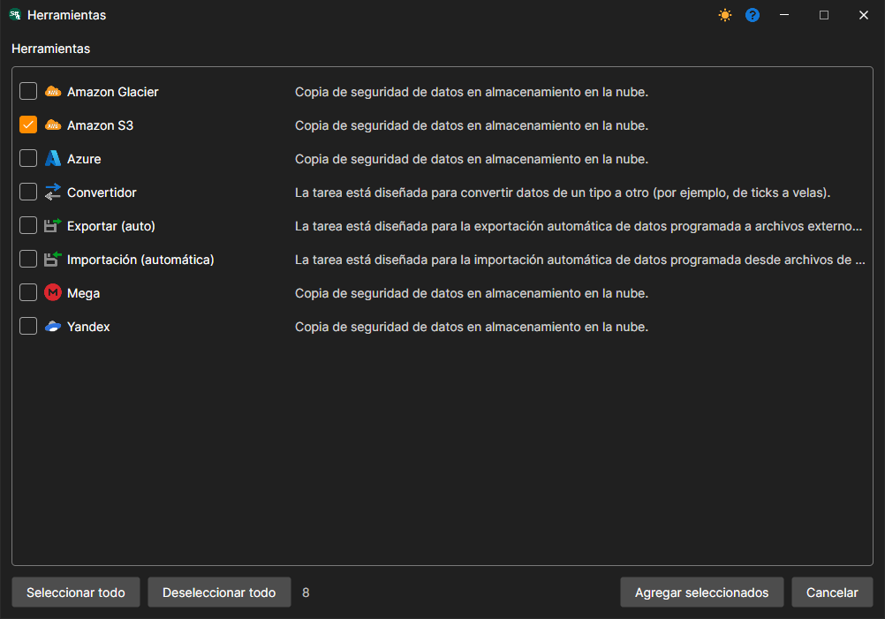
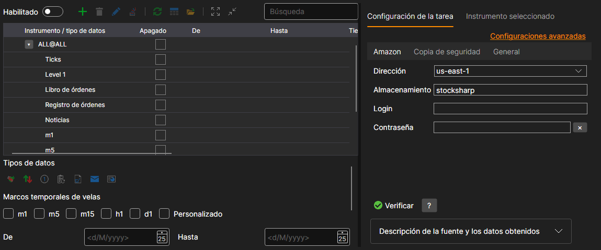
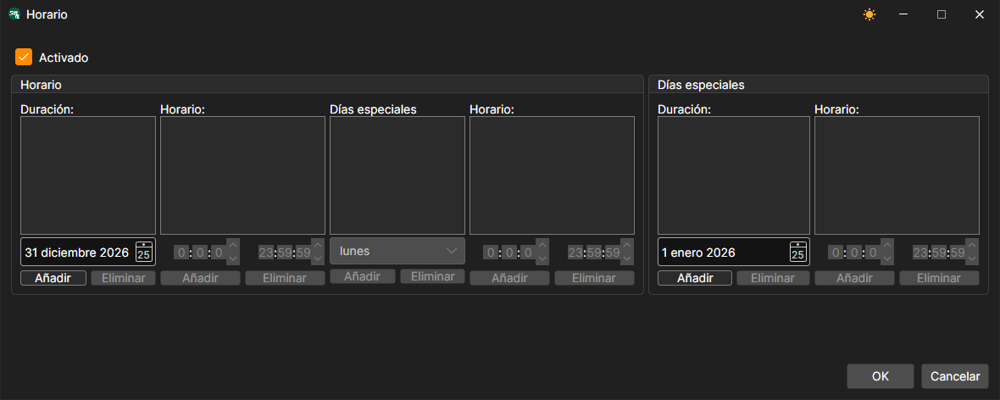

# Configuración de Hydra

A continuación se describe cómo crear y configurar una tarea de copia de seguridad.

1. Para crear una tarea, haga clic en el botón **Herramientas**; en la ventana que se abre, marque el elemento **Amazon S3** y haga clic en el botón **Agregar seleccionados**. A la pregunta de si desea habilitar la tarea ahora, puede responder **No**: la tarea se habilita con el interruptor después de configurarla.
2. Después debe configurar la tarea. La configuración está dividida en pestañas, y el enlace **Configuraciones avanzadas** la muestra entera en una sola lista.

   **Amazon**
   - **Dirección** - región especificada en la configuración del bucket. Consulte [Regiones y endpoints](https://docs.aws.amazon.com/general/latest/gr/rande.html#s3_region).
   - **Almacenamiento** - nombre del bucket.
   - **Inicio de sesión** - clave de acceso **Access Key ID**.
   - **Contraseña** - clave de acceso **Secret Access Key**.

   **Copia de seguridad**
   - **Carpeta** - carpeta en la nube a la que se suben los datos. Si no se especifica, los datos se suben a la raíz del bucket.
   - **Desfase temporal** - desplazamiento en días desde la fecha actual, para no copiar los datos de una sesión de negociación no finalizada.
   - **Errores** - cuántas veces se repite una operación fallida (creación de una carpeta, subida de un archivo) antes de que la tarea informe de un error.

   **General**
   - **Continuar** - continuar la copia desde la última fecha copiada.
   - **Intervalo de operación** - intervalo de operación.
   - **Directorio de datos** - directorio de datos desde el que se recibirán los datos para la conversión.
   - **Formato** - formato de los datos convertidos: BIN\/CSV.
   - **Máx. errores** - número máximo de errores tras el cual la tarea se detendrá. De forma predeterminada, 0: se ignora el número de errores.
   - **Encabezado** - título de la tarea.
   - **Horario de trabajo** - horario de trabajo de la tarea. Al marcar la casilla del campo, se activa el botón **...**, que abre el editor de horarios.

   **Registro**
   - **Nivel de registro** - nivel de registro.
3. Después de configurar la tarea, añada los instrumentos que deben guardarse en el almacenamiento de copia de seguridad y haga clic en el botón **Iniciar**.

## Contenido recomendado

[Creación y configuración de una cuenta](setup.md)
