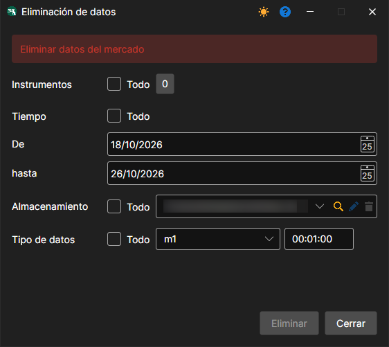

# Eliminar datos

En el menú **Datos del mercado**, seleccione la opción **Eliminar datos...**.

Permite eliminar los datos de todos los instrumentos o de instrumentos concretos para fechas específicas.
