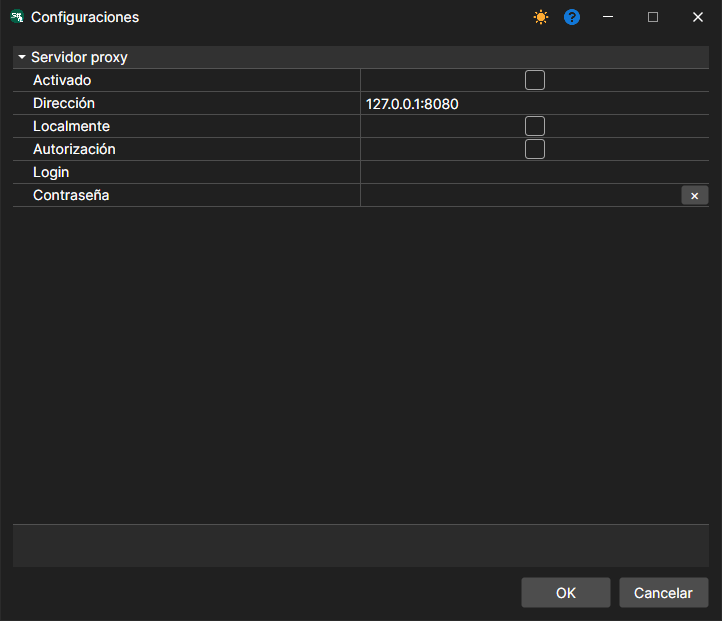

# Configuración de red

Menú **Archivo \=\> Configuración del proxy**. (La opción **Servidor \=\> Configuración de red** corresponde a la configuración del [modo servidor](../server_mode/settings.md).)

Permite configurar los ajustes del proxy.
