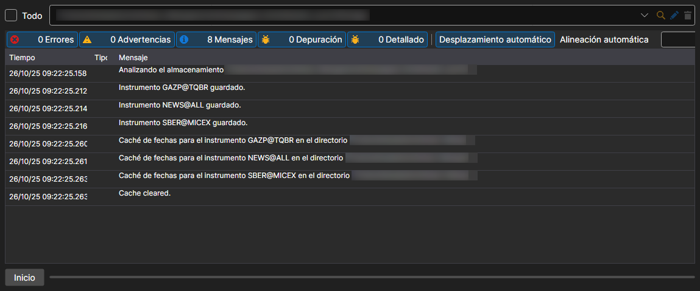

# Sincronización

Menú **Importar \=\> Sincronizar...**.

Permite recuperar los instrumentos desde los archivos descargados.

La opción **Importar \=\> Construir índice** reconstruye el índice del almacenamiento, es decir, la lista de qué datos contiene y de qué días. Hydra también reconstruye el índice por sí sola, con el intervalo que se define en la configuración general.
