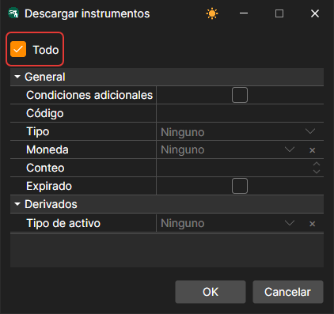
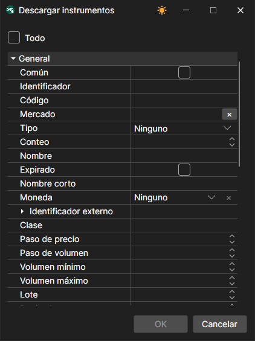
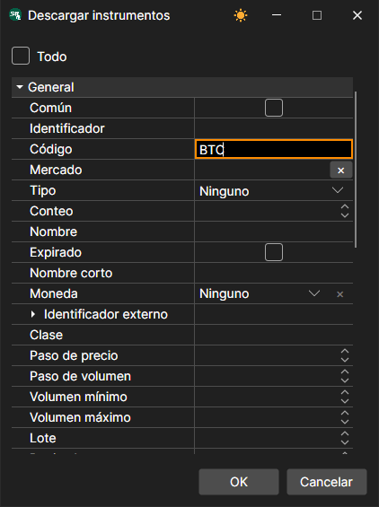
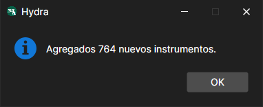
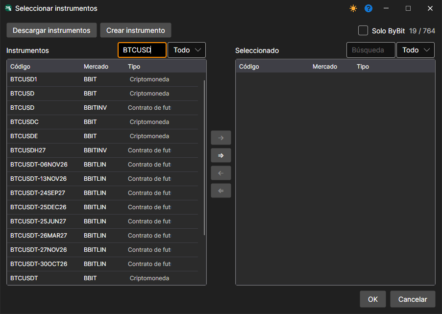
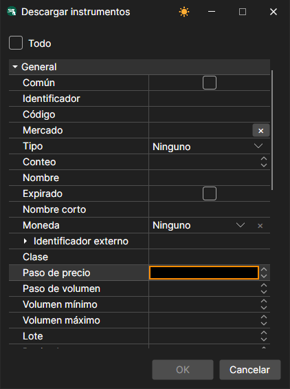
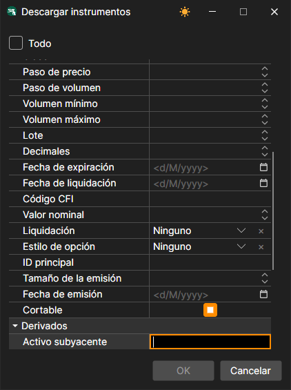

# Lista de instrumentos

Configuración del instrumento para la descarga.

Para varias fuentes, es posible configurar la descarga de los instrumentos necesarios.

Tomemos como ejemplo la descarga de instrumentos desde la fuente **ByBit**:

1. Haga clic en **Descargar instrumentos**. De forma predeterminada está marcada la opción **Todo**: se descargarán todos los instrumentos de la fuente.
2. Desmarque **Todo** y marque **Condiciones adicionales**. Después se abrirá una lista de configuración avanzada para el instrumento descargado; la opción **Común** vuelve a la lista breve.
3. Hay que descargar los instrumentos cuyo código contiene BTC. Para ello, indique BTC en el campo **Código** y haga clic en **OK**.

   Después de esto, el programa [Hydra](../../hydra.md) descargará todos los instrumentos que cumplan los parámetros especificados e informará de cuántos de ellos son nuevos. 

La configuración permite al usuario seleccionar varios parámetros para el instrumento descargado.

Así, por ejemplo, el usuario puede seleccionar:

- **Paso de precio y volumen**
- **Volúmenes mínimo y máximo**
- **ID externo** 
- Para opciones, permite establecer el **Activo subyacente** y el **Tipo de activo** (tipo del instrumento subyacente). 

**Ver [tutorial en video](../videos/instruments_downloading.md)**
