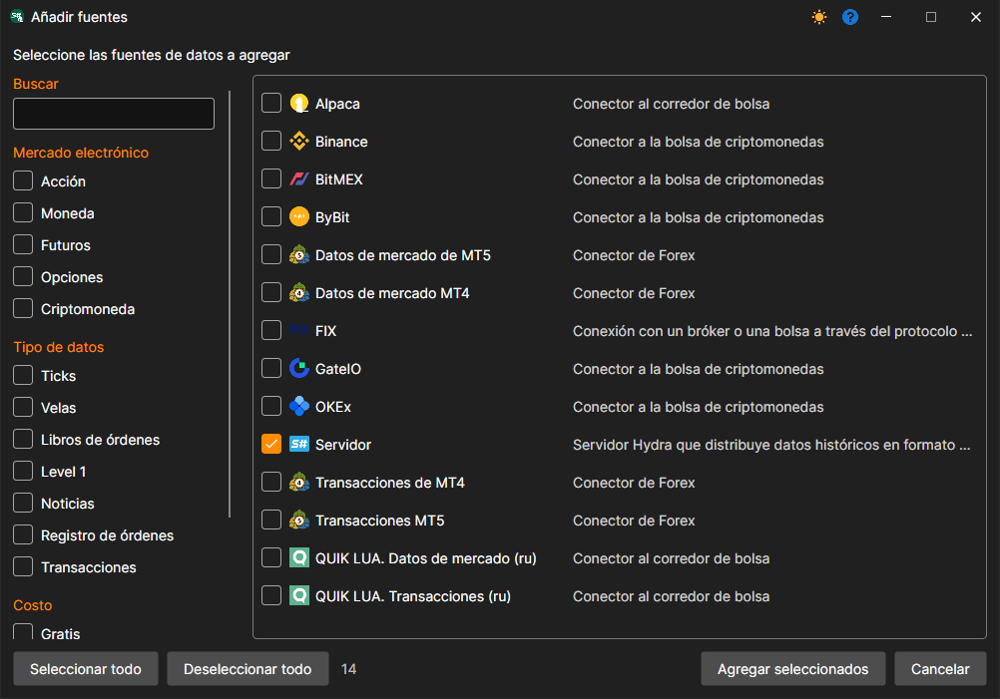
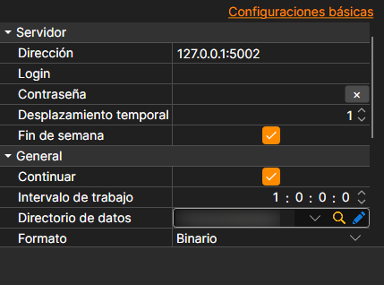

# Conexión de un cliente Hydra

En modo servidor, es posible conectar otro programa Hydra, que actuará como cliente y descargará datos para sí mismo. A diferencia de [Conexión mediante protocolo FIX](fix_fast_connectivity.md), los datos se transmiten en forma de archivos en formato StockSharp. Esto hace que la fuente sea adecuada para transferir un gran volumen de datos históricos.

Para la conexión se usa la fuente **Servidor**: hay que marcarla en la ventana que se abre con el botón **+** de la sección **Fuentes** y pulsar **Agregar seleccionados**.

**Configuración**

**Servidor**

- **Dirección** - dirección del servidor Hydra.
- **Inicio de sesión** - inicio de sesión (obligatorio si el servidor requiere autorización).
- **Contraseña** - contraseña (obligatoria si el servidor requiere autorización).
- **Desfase temporal** - desplazamiento de tiempo en días desde la fecha actual, necesario para evitar descargar datos incompletos de la sesión de negociación actual.
- **Fines de semana** - indica si se deben omitir los fines de semana.

**Principal**

- **Continuar** - continuar la descarga desde la última fecha descargada.
- **Intervalo de operación** - intervalo de operación.
- **Directorio de datos** - directorio con datos donde se guardarán los archivos finales en formato [S#](../../api.md).
- **Formato** - formato de datos: BIN/CSV.
- **Máx. errores** - número máximo de errores al alcanzarse el cual la tarea se detendrá. De forma predeterminada, 0: se ignora el número de errores.
- **Título** - nombre de la tarea.
- **Horario de trabajo** - horario de trabajo de la tarea.
- **Validación** - qué hacer con los datos que no superan la validación: nada, eliminarlos o detener la suscripción.

**Remotamente**

- **Habilitado** - controlar la tarea de forma remota.
- **Notificación** - canal al que llegan las notificaciones sobre la tarea.
- **Nivel de registro** - qué mensajes de la tarea se envían al canal.

**Registro**

- **Nivel de registro** - nivel de registro.
